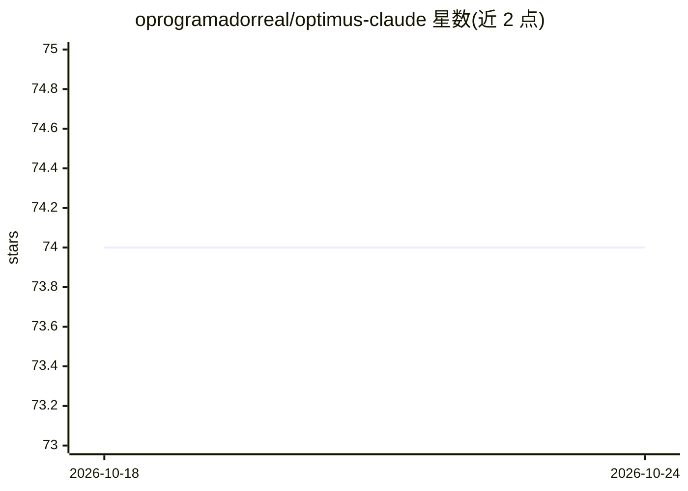

# oprogramadorreal/optimus-claude

⭐ 74 · Python · MIT · 推送 2026-09-28 · [GitHub](https://github.com/oprogramadorreal/optimus-claude) · 个人维护

**为 Claude Code 准备项目上下文的工程技能插件**

面向 Claude Code 的插件（实验性支持 OpenAI Codex CLI）：init 读取代码库生成项目规范、CLAUDE.md 指令与测试基础设施，并提供一组质量技能——TDD、代码审查、重构、可跨会话续跑的 deep 修复循环、commit/PR/worktree 等工具。技能由用户调用，生成的项目文档随仓库存在，可脱离插件使用。Codex 侧部分技能不支持（permissions/dream/格式化钩子），编排功能标注为实验性。

## 筛选速览

| 维度 | 判定 | 备注 |
|---|---|---|
| AI 角色 | `ai-ecosystem` | LLM/agent 周边工具 |
| 许可风险 | `permissive` | MIT |
| 部署形态 | `desktop` | 安装包/桌面程序 |
| 模型依赖 | locked-api |  |
| 硬件要求 | — | 无带数字的原话,不猜 |
| 安装摩擦 | `low` | 无编译、无系统依赖或容器化 |
| 成熟度 | `idea` | |

## 能力要点

- init 从代码库生成项目规范、CLAUDE.md 与测试基础设施
- TDD、code-review、refactor、可续跑的 deep 修复循环等质量技能
- 实验性支持 OpenAI Codex CLI，附技能支持矩阵
- 生成的项目文档随仓库保留，可脱离插件使用

## 适用场景

- 为 AI 编码代理准备项目规范与测试基础设施
- 以 TDD/审查/重构技能约束 AI 生成的代码质量
- 长任务用 deep 循环与 handoff 跨会话续跑

## 场景标签

`代码审查` · 领域:编码与开发

## 证据(README 行号)

> L9: **A plugin that sets up your project for effective AI-assisted engineering in Claude Code, with experimental OpenAI 
> L13: **The solution:** Optimus generates project instructions, coding guidelines, and test infrastructure from your actu

## 星数曲线

2026-10-18 74 → 2026-10-24 74（+0）

---
*卡片 v1 · prompt 1.4 · 生成 2026-10-24 · 置信度 high · 依据 README sha `88adac6bdc24` · [字段定义](../../DATASET.md)*
