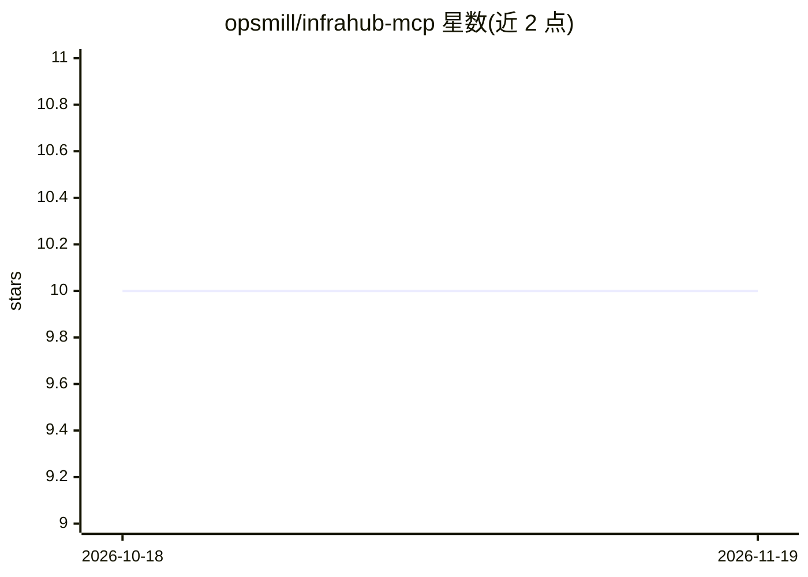

# opsmill/infrahub-mcp

⭐ 10 · Python · Apache-2.0 · 推送 2026-11-16 · [GitHub](https://github.com/opsmill/infrahub-mcp) · [官网](https://docs.infrahub.app) · 组织维护

**把 AI 助手/Agent 接入 Infrahub 管理基础设施数据的 MCP 服务器**

基于 Model Context Protocol 的服务器，连接 AI 助手与 IDE Agent 到 Infrahub 基础设施源真平台，使其能以自然语言查询设备、接口、IP 等数据，执行 GraphQL 查询/变更，并将写入落到自动创建的会话分支、经人工审批合并，默认分支不被直接修改。支持 stdio 与 Streamable HTTP 两种传输方式，兼容 Claude Desktop、VS Code、Cursor 等 MCP 客户端，无需额外胶水代码。以 pip/uv 包与 Docker 镜像提供，Apache 2.0 许可。

## 筛选速览

| 维度 | 判定 | 备注 |
|---|---|---|
| AI 角色 | `ai-ecosystem` | LLM/agent 周边工具 |
| 许可风险 | `permissive` | Apache-2.0 |
| 部署形态 | `self-host` | docker 或自建部署 |
| 模型依赖 | — | README 未给出锁定关系 |
| 硬件要求 | — | 无带数字的原话,不猜 |
| 安装摩擦 | `low` | 无编译、无系统依赖或容器化 |
| 成熟度 | — | 结构信号不足 |

## 能力要点

- 通过 MCP 标准接入任意 MCP 兼容客户端（Claude Desktop、VS Code、Cursor 等）
- 自然语言查询基础设施数据，支持属性过滤与部分匹配搜索
- 写入分支隔离，需人工审批合并，默认分支不被直接修改
- 支持 stdio 与 Streamable HTTP 传输，可 pip/uv/Docker 部署

## 适用场景

- 让 IDE 中的编码 Agent 查询与变更网络基础设施源真数据
- 在对话中探索 schema、执行 GraphQL 查询
- 由 Agent 起草变更并提交 Proposed Change 供人工审批

## 场景标签

`编码 Agent` `AI 助手` · 领域:编码与开发

## 证据(README 行号)

> L3: Infrahub MCP Server connects AI assistants and IDE agents to Infrahub using the open Model Context Protocol standard
> L5: All writes are branch-isolated and require human approval before merging — agents never modify your default branch d

## 星数曲线

2026-10-18 10 → 2026-11-19 10（+0）

---
*卡片 v1 · prompt 1.4 · 生成 2026-11-19 · 置信度 high · 依据 README sha `a0c491f4a893` · [字段定义](../../DATASET.md)*
