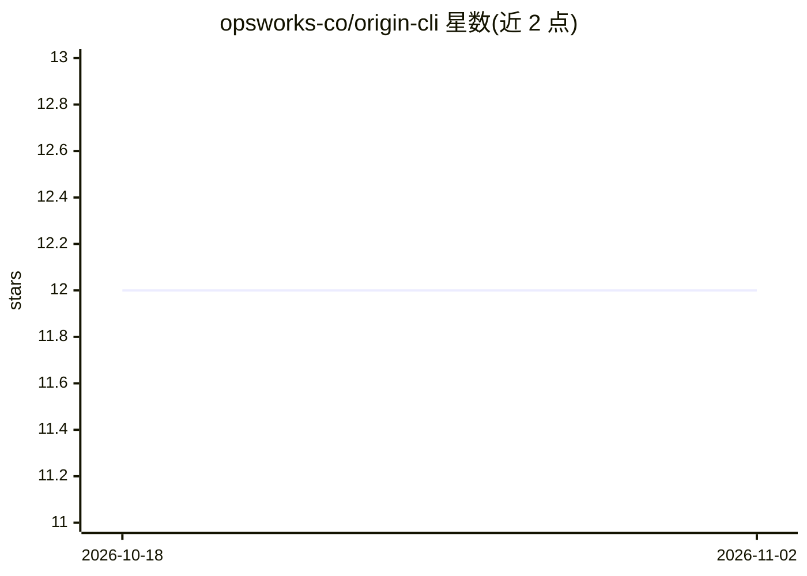

# opsworks-co/origin-cli

⭐ 12 · TypeScript · MIT · 推送 2026-10-29 · [GitHub](https://github.com/opsworks-co/origin-cli) · [官网](https://getorigin.io) · 组织维护

**AI 编码行为的归因与治理 CLI：记录哪个 agent 写了哪行代码**

运行在 git 仓库旁的命令行工具：通过 git hooks 捕获 AI 编码 agent（Claude Code、Cursor、Codex、Gemini CLI、Copilot 等）的会话，记录提示词、触及文件、token、费用与 diff，存为 git notes 与 refs，随 git clone 一起携带，无需服务器、登录或 API key。提供行级归因（origin blame）、提示词溯源（origin why）、会话回放、跨会话记忆等 50+ 命令。会话记忆默认本地运行不调用 LLM；仓库简报为可选功能，需自带 Anthropic key。另提供付费团队平台 getorigin.io（$29/用户/月）。

## 筛选速览

| 维度 | 判定 | 备注 |
|---|---|---|
| AI 角色 | `ai-ecosystem` | LLM/agent 周边工具 |
| 许可风险 | `permissive` | MIT |
| 部署形态 | `library` | 以包/库形式分发 |
| 模型依赖 | — | README 未给出锁定关系 |
| 硬件要求 | — | 无带数字的原话,不猜 |
| 安装摩擦 | `low` | 无编译、无系统依赖或容器化 |
| 成熟度 | — | 结构信号不足 |

## 能力要点

- 行级 AI/人类归因与提示词溯源（origin blame / origin why）
- 会话数据以 git notes 与 refs 形式存于仓库内，随 clone 携带
- 支持原生钩子捕获 7 种 agent，提交时检测 9 种以上工具
- 跨会话记忆默认 100% 本地、不调用 LLM

## 适用场景

- 查看某行代码由哪个 AI agent、哪条提示词写出
- 统计仓库中 AI 与人类编码占比及模型费用
- 团队对 AI 编码做审计与 PR 合规检查（配合团队平台）

## 场景标签

`Agent 记忆` · 领域:Agent 开发

## 证据(README 行号)

> L11: Origin runs silently next to any AI coding agent — Claude Code, Cursor, Codex,
> L28: origin blame src/index.ts       # see which AI wrote each line
> L75: Nothing leaves your machine. Sessions live in `refs/notes/origin`, per-session

## 星数曲线

2026-10-18 12 → 2026-11-02 12（+0）

---
*卡片 v1 · prompt 1.4 · 生成 2026-11-01 · 置信度 high · 依据 README sha `f9c645139e80` · [字段定义](../../DATASET.md)*
