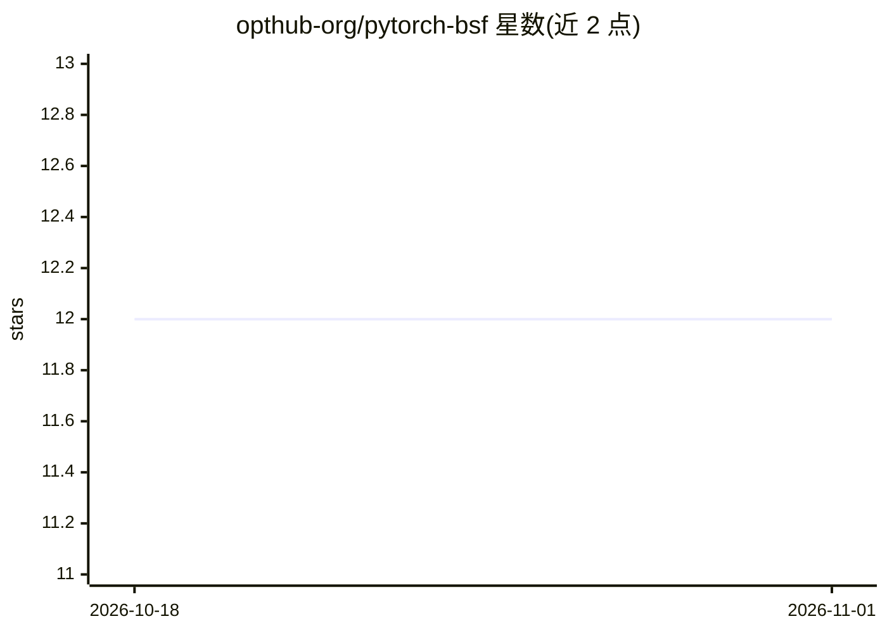

# opthub-org/pytorch-bsf

⭐ 12 · Python · MIT · 推送 2026-10-31 · [GitHub](https://github.com/opthub-org/pytorch-bsf) · [官网](https://pypi.org/project/pytorch-bsf/) · 组织维护

**PyTorch 的 Bézier 单纯形体拟合库：曲线曲面回归与插值**

PyTorch-BSF 是基于 PyTorch 的 Python 库，用于将参数化曲线、曲面与高维模型（Bézier 单纯形、单纯形体）拟合到数据。提供回归与点云拟合、单形/乘积/拼接胞腔域与共享控制点、稠密 SVD 与稀疏 LSMR 最小二乘求解、交叉验证与度数选择、模型归档复用等功能，可选集成 scikit-learn、Lightning 与 MLflow。适用于多目标优化中逼近 Pareto 前沿、构建代理响应模型与网格插值。核心拟合在 CPU float64 上运行，需 Python 3.11+ 与 PyTorch 2.3+。同时提供 Python API 与命令行两种入口。

## 筛选速览

| 维度 | 判定 | 备注 |
|---|---|---|
| AI 角色 | `ai-native` | 本体是模型或模型工具 |
| 许可风险 | `permissive` | MIT |
| 部署形态 | `library` | 以包/库形式分发 |
| 模型依赖 | — | README 未给出锁定关系 |
| 硬件要求 | — | 无带数字的原话,不猜 |
| 安装摩擦 | `low` | 无编译、无系统依赖或容器化 |
| 成熟度 | `idea` | |

## 能力要点

- 回归与点云拟合两种入口，及对可微代价函数的系数优化
- 支持单形、乘积域、拼接胞腔与共享控制点、精确固定控制点与二次正则化
- 稠密 SVD 与可选稀疏 LSMR 求解器，含误差、条件数与终止状态诊断
- 提供交叉验证、度数选择、集成、Sobol/网格采样与版本化模型归档

## 适用场景

- 多目标优化中用小样本拟合并逼近 Pareto 前沿
- 为仿真或实验数据构建代理响应模型
- 在单纯形网格上做保形插值与预测
- 通过 CLI 以 CSV 输入完成拟合与预测流程

## 场景标签

 · 领域:科学计算/机器学习

## 证据(README 行号)

> L14: PyTorch-BSF is a Python library for fitting parametric curves, surfaces and
> L31: - **Regression and point cloud fitting:** fit known parameter-response pairs,

## 星数曲线

2026-10-18 12 → 2026-11-01 12（+0）

---
*卡片 v1 · prompt 1.4 · 生成 2026-11-01 · 置信度 mid · 依据 README sha `47a31be193eb` · [字段定义](../../DATASET.md)*
