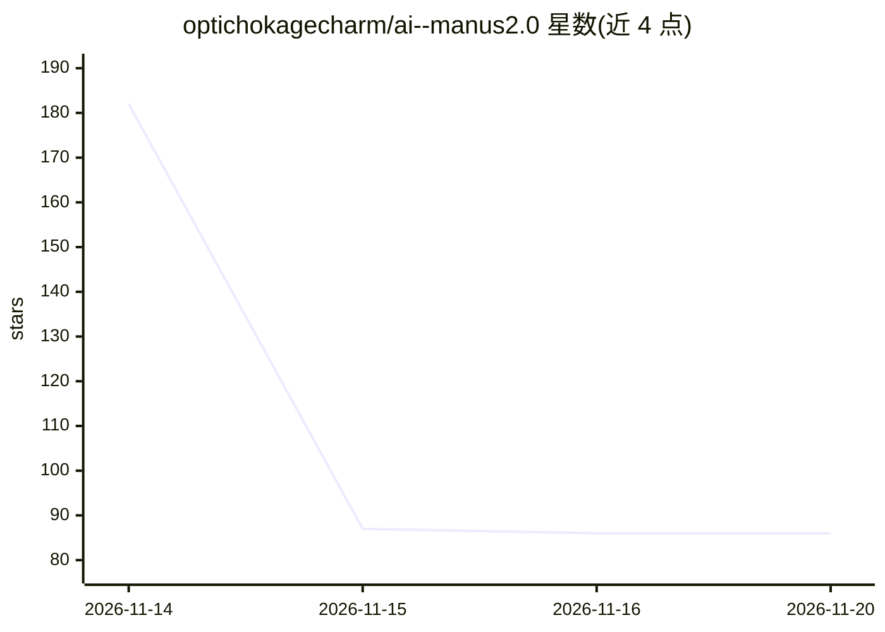

# optichokagecharm/ai--manus2.0

⭐ 86 · Apache-2.0 · 推送 2026-11-15 · [GitHub](https://github.com/optichokagecharm/ai--manus2.0) · 个人维护

**面向个人用户的自主 AI Agent：代替用户执行代码与浏览器操作**

README 描述的 Manus 是一个自主 AI Agent，定位为家庭、学习与轻量办公场景的个人助手：可自行编写并执行脚本、控制浏览器（导航、填表、采集信息）、执行多步骤任务，代码与浏览器操作可在同一工作流中衔接。兼容性表列出最低双核 CPU、4GB 内存、64 位系统等要求。使用流程为配置、测试、逐步扩大自动化范围。README 未给出任何具体安装命令、技术栈、模型接入方式或代码仓库内容，页面包含下载码 PROMO2026 与大量搜索关键词。

## 筛选速览

| 维度 | 判定 | 备注 |
|---|---|---|
| AI 角色 | `ai-native` | 本体是模型或模型工具 |
| 许可风险 | `permissive` | Apache-2.0 |
| 部署形态 | `None` |  |
| 模型依赖 | — | README 未给出锁定关系 |
| 硬件要求 | — | 无带数字的原话,不猜 |
| 安装摩擦 | `low` | 无编译、无系统依赖或容器化 |
| 成熟度 | — | 结构信号不足 |

## 能力要点

- 自主编写并执行脚本完成任务（L10、L18）
- 浏览器控制：导航、填表、信息采集（L11、L18）
- 代码与浏览器操作在同一工作流中衔接（L14、L24）
- 会话间记忆重复工作流模式（L24）

## 适用场景

- 让代理代为完成重复性代码与浏览器操作
- 收集研究资料、整理笔记与跑小型脚本
- 远程排查时快速查看系统页面与整理诊断步骤

## 场景标签

`AI 助手` `浏览器自动化` · 领域:效率与自动化

## 证据(README 行号)

> L10: - **Autonomous Code Execution:** Manus AI agent runs code on its own to complete tasks, so you can focus on decisio
> L18: Manus is an autonomous AI agent designed to run code and control a browser on your behalf. Instead of acting like a
> L22: Manus is not a heavy studio suite or a complex enterprise platform. It is a focused helper built for home, study, a

## 星数曲线

2026-11-14 182 → 2026-11-20 86（-96）

---
*卡片 v1 · prompt 1.4 · 生成 2026-11-17 · 置信度 mid · 依据 README sha `637da4fbcded` · [字段定义](../../DATASET.md)*
