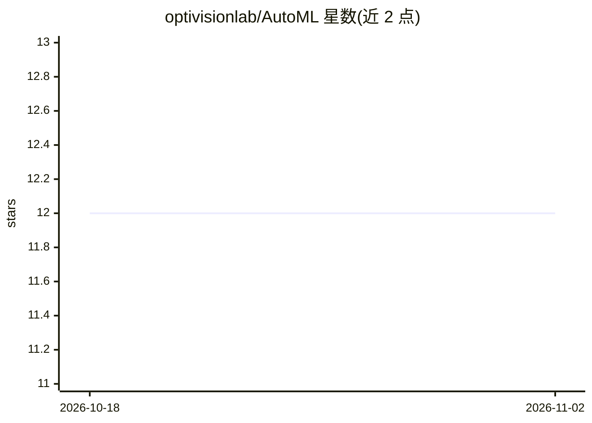

# optivisionlab/AutoML

⭐ 12 · TypeScript · NOASSERTION · 推送 2026-11-01 · [GitHub](https://github.com/optivisionlab/AutoML) · [官网](https://optivisionlab.fit-haui.edu.vn/) · 组织维护

**分布式 AutoML 平台：自动完成从预处理到模型部署的 ML 流程**

由越南河内工业大学 OptiVisionLab 实验室开发的 AutoML 系统，面向包括不具备深度机器学习背景的用户：上传数据后自动完成数据类型检测与预处理、模型选择、超参数搜索（Grid/Random/贝叶斯/遗传算法），并提供推理 API。技术上采用微服务架构：Next.js 前端、FastAPI 后端、MongoDB 存储、Apache Kafka 任务队列、多 worker 并行训练、MinIO 对象存储，v2.2.0 起支持 MapReduce 分布式计算与智能调度。支持分类与回归任务，配套发表论文（Springer，DOI 见 README）。

## 筛选速览

| 维度 | 判定 | 备注 |
|---|---|---|
| AI 角色 | `ai-ecosystem` | LLM/agent 周边工具 |
| 许可风险 | `none` | NOASSERTION |
| 部署形态 | `self-host` | docker 或自建部署 |
| 模型依赖 | — | README 未给出锁定关系 |
| 硬件要求 | — | 无带数字的原话,不猜 |
| 安装摩擦 | `low` | 无编译、无系统依赖或容器化 |
| 成熟度 | — | 结构信号不足 |

## 能力要点

- 自动数据类型检测与预处理（标准化、one-hot、TF-IDF、缺失值填充）
- Grid/Random/贝叶斯/遗传算法等超参数搜索与交叉验证
- Kafka 任务队列 + 多 worker 并行训练，v2.2.0 分布式计算与智能调度
- 模型部署与推理 API，Next.js + FastAPI 微服务架构

## 适用场景

- 无机器学习专长的用户上传数据自动训练模型
- 科研环境中并行运行繁重的超参数搜索任务
- 通过 API 对新数据执行预测推理

## 场景标签

`MLOps` · 领域:训练与推理

## 证据(README 行号)

> L7: Đây là một hệ thống toàn diện cho phép người dùng (bao gồm cả những người không có chuyên môn sâu về học máy) dễ dàn
> L11: HAutoML là một hệ thống AutoML phân tán, được thiết kế để **tự động hóa toàn bộ pipeline học máy** từ tiền xử lý dữ

## 星数曲线

2026-10-18 12 → 2026-11-02 12（+0）

---
*卡片 v1 · prompt 1.4 · 生成 2026-11-01 · 置信度 high · 依据 README sha `82c05b90bbc6` · [字段定义](../../DATASET.md)*
