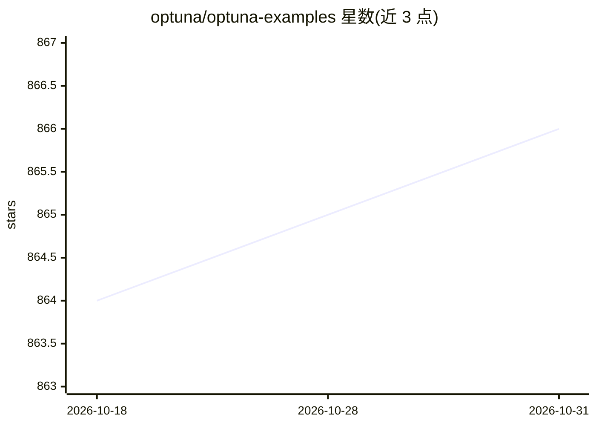

# optuna/optuna-examples

⭐ 866 · Python · MIT · 推送 2026-10-30 · [GitHub](https://github.com/optuna/optuna-examples) · 组织维护

**Optuna 官方示例代码集：超参数优化各场景示例索引**

Optuna 官方维护的示例代码仓库：以链接清单形式组织覆盖黑盒优化、多目标优化、机器学习框架集成（PyTorch/LightGBM/XGBoost/Transformers 等 20 余种）、剪枝、采样器、终止器、可视化、分布式优化（Dask/Kubernetes/Ray）与 MLOps 平台跟踪等场景的示例代码，并列出使用 Optuna 的外部项目。大部分示例提供以 -dev 结尾标签的 Docker 镜像，可通过 docker run 运行，可视化示例支持 Jupyter Notebook。

## 筛选速览

| 维度 | 判定 | 备注 |
|---|---|---|
| AI 角色 | `ai-knowledge` | 知识聚合/清单类 |
| 许可风险 | `permissive` | MIT |
| 部署形态 | `self-host` | docker 或自建部署 |
| 模型依赖 | — | README 未给出锁定关系 |
| 硬件要求 | — | 无带数字的原话,不猜 |
| 安装摩擦 | `low` | 无编译、无系统依赖或容器化 |
| 成熟度 | — | 结构信号不足 |

## 能力要点

- 覆盖 20 余种机器学习框架的优化示例
- 剪枝/采样器/终止器/分布式优化等进阶场景示例
- 外部项目使用 Optuna 的案例列表
- 提供 -dev 标签 Docker 镜像运行示例

## 适用场景

- 查找与自身 ML 框架匹配的 Optuna 超参数调优写法
- 学习剪枝、分布式优化、自定义采样器等进阶用法
- 通过 Docker 镜像直接运行示例验证环境

## 场景标签

`教程课程` · 领域:学习与行业

## 证据(README 行号)

> L3: This page contains a list of example codes written with Optuna.
> L19: > In this example repository, you can also find the examples for the following scenarios:

## 星数曲线

2026-10-18 864 → 2026-10-31 866（+2）

---
*卡片 v1 · prompt 1.4 · 生成 2026-10-21 · 置信度 high · 依据 README sha `53b35d4a9435` · [字段定义](../../DATASET.md)*
