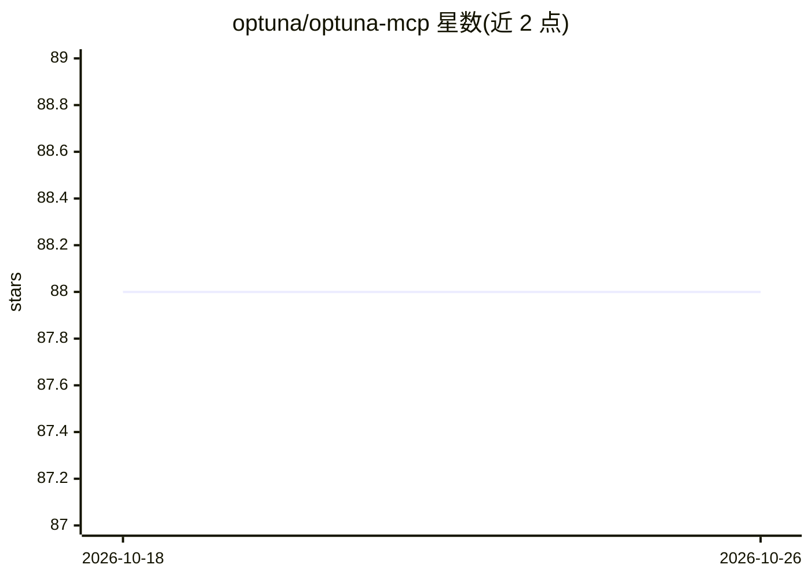

# optuna/optuna-mcp

⭐ 88 · Python · MIT · 推送 2026-10-22 · [GitHub](https://github.com/optuna/optuna-mcp) · 组织维护

**让 LLM 通过 MCP 调用 Optuna 做超参优化的服务器**

基于 Model Context Protocol 的服务器，把 Optuna 的核心功能（Study/Trial/可视化/Dashboard）以工具形式暴露给 MCP 客户端（如 Claude Desktop）。用户通过自然语言对话即可创建 study、用 ask/tell 建议与上报参数、绘制优化历史与 Pareto 前沿图、启动 Optuna dashboard。支持 uv 或 Docker 安装，可通过 --storage 参数持久化结果到 Optuna 存储。面向使用 LLM 客户端做自动化超参优化与结果分析的开发者，示例覆盖 2D-Sphere 函数、FFmpeg 编码参数、曲奇配方与 Matplotlib 配置优化。

## 筛选速览

| 维度 | 判定 | 备注 |
|---|---|---|
| AI 角色 | `ai-ecosystem` | LLM/agent 周边工具 |
| 许可风险 | `permissive` | MIT |
| 部署形态 | `library` | 以包/库形式分发 |
| 模型依赖 | — | README 未给出锁定关系 |
| 硬件要求 | — | 无带数字的原话,不猜 |
| 安装摩擦 | `medium` | 含编译或系统依赖之一 |
| 成熟度 | — | 结构信号不足 |

## 能力要点

- 以 MCP 工具形式提供 Optuna 的 Study/Trial/Visualization/Dashboard 原语
- ask/tell 模式支持 LLM 驱动的参数建议与结果上报
- 提供优化历史、Pareto 前沿、参数重要性等 10 种可视化工具
- 支持通过 --storage 参数持久化优化结果

## 适用场景

- 在 Claude Desktop 中用自然语言完成超参优化流程
- 通过聊天界面对 Optuna 优化结果做交互式分析与可视化
- 优化 FFmpeg 编码参数、Matplotlib 配置等外部工具的输入输出

## 场景标签

`MLOps` · 领域:训练与推理

## 证据(README 行号)

> L8: A Model Context Protocol (MCP) server that automates optimization and analysis using Optuna.
> L16: - Automated hyperparameter optimization by LLMs
> L65: ## Tools provided by Optuna MCP

## 星数曲线

2026-10-18 88 → 2026-10-26 88（+0）

---
*卡片 v1 · prompt 1.4 · 生成 2026-10-23 · 置信度 high · 依据 README sha `2be133150fb0` · [字段定义](../../DATASET.md)*
