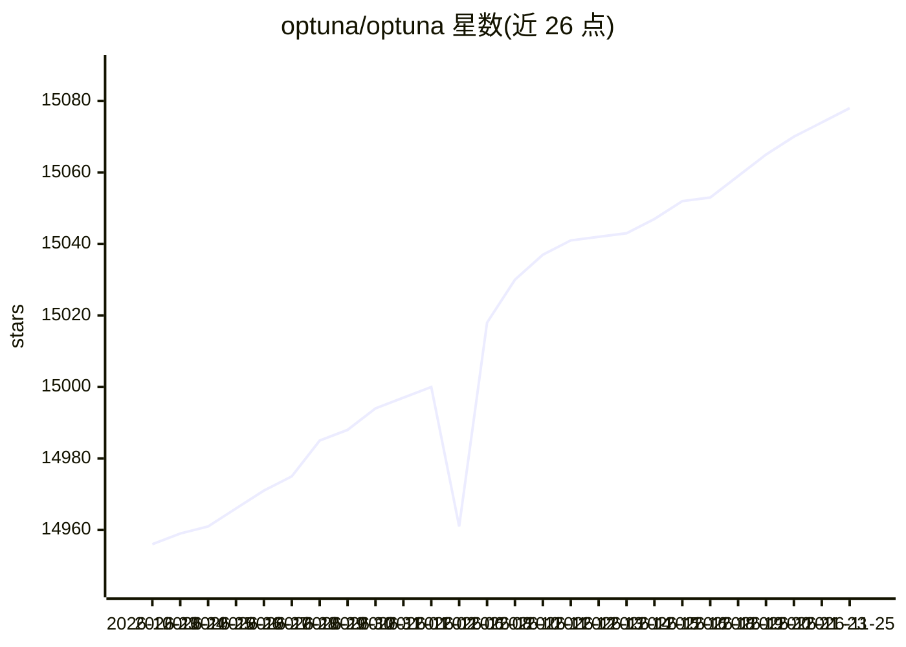

# optuna/optuna

⭐ 15,078 · Python · MIT · 推送 2026-11-18 · [GitHub](https://github.com/optuna/optuna) · [官网](https://optuna.org) · 组织维护

**为机器学习开发者自动搜索超参数的 Python 优化框架**

面向机器学习的自动超参数优化框架，采用 define-by-run 命令式 API，用户用 Python 语法（含条件与循环）动态构造搜索空间；提供采样与剪枝算法、study/trial 抽象、多目标与约束优化支持，可将任务扩展到数十至数百个 worker 并行。配套生态包括 Rust 实现的 Rustuna（实验性）、实时 Web Dashboard 与功能共享平台 OptunaHub。以 PyPI/conda 包分发，要求 Python 3.10+，MIT 许可，由 Preferred Networks 维护。

## 筛选速览

| 维度 | 判定 | 备注 |
|---|---|---|
| AI 角色 | `ai-ecosystem` | LLM/agent 周边工具 |
| 许可风险 | `permissive` | MIT |
| 部署形态 | `library` | 以包/库形式分发 |
| 模型依赖 | — | README 未给出锁定关系 |
| 硬件要求 | — | 无带数字的原话,不猜 |
| 安装摩擦 | `low` | 无编译、无系统依赖或容器化 |
| 成熟度 | — | 结构信号不足 |

## 动量与使用信号

- 维护:`active` — 距上次 push 2.2 天,年发版 6,317 位贡献者
- 涨星:近 1 天 **+5**(自 20261016 起算)
- 安装:pypi 包 `optuna` 月下载 15,257,921

## 能力要点

- define-by-run API 动态构造搜索空间
- 采样与剪枝算法，支持多目标与约束优化
- 少量或无需改码即可并行扩展到数百 worker
- 配套 Optuna Dashboard 与 OptunaHub 功能共享平台

## 适用场景

- 为机器学习模型自动搜索最优超参数组合
- 分布式环境下并行运行大规模优化任务
- 通过可视化图表检查优化历史与超参数重要性

## 场景标签

`MLOps` · 领域:训练与推理

## 证据(README 行号)

> L18: *Optuna* is an automatic hyperparameter optimization software framework, particularly designed
> L43:  - Adopt state-of-the-art algorithms for sampling hyperparameters and efficiently pruning unpromising trials.
> L206: Optuna is developed and maintained by Preferred Networks™

## 星数曲线

2026-10-23 14,956 → 2026-11-25 15,078（+122）

---
*卡片 v1 · prompt 1.4 · 生成 2026-11-22 · 置信度 high · 依据 README sha `ae8f96b38900` · [字段定义](../../DATASET.md)*
