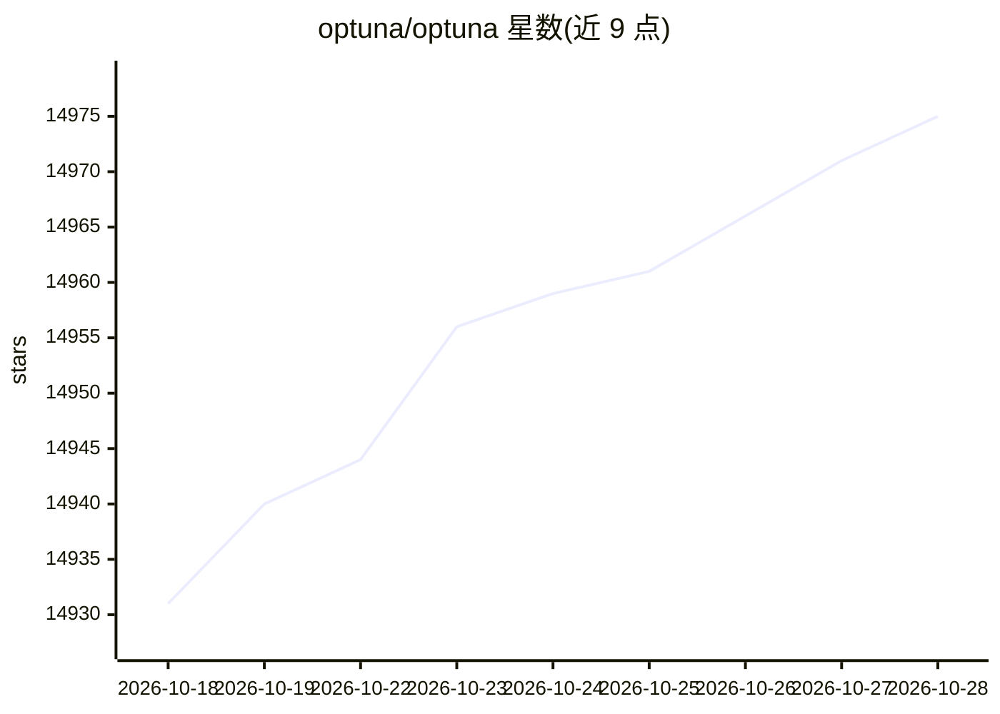

# optuna/optuna

⭐ 14,975 · Python · MIT · 推送 2026-10-23 · [GitHub](https://github.com/optuna/optuna) · [官网](https://optuna.org) · 组织维护

**面向机器学习的超参数自动优化 Python 框架**

为机器学习提供超参数优化的 Python 框架，采用 define-by-run 命令式 API，用户可用普通 Python 语法（含条件与循环）动态构建搜索空间。核心机制包括采样与剪枝算法、study/trial 抽象、以少量代码改动扩展到数十至数百 worker 的并行化，以及优化历史绘图。另提供 Rust 实现的实验性版本 Rustuna、Web 仪表盘 optuna-dashboard 与特性共享平台 OptunaHub。要求 Python 3.10 及以上，MIT 许可。

## 筛选速览

| 维度 | 判定 | 备注 |
|---|---|---|
| AI 角色 | `ai-ecosystem` | LLM/agent 周边工具 |
| 许可风险 | `permissive` | MIT |
| 部署形态 | `library` | 以包/库形式分发 |
| 模型依赖 | — | README 未给出锁定关系 |
| 硬件要求 | — | 无带数字的原话,不猜 |
| 安装摩擦 | `low` | 无编译、无系统依赖或容器化 |
| 成熟度 | — | 结构信号不足 |

## 动量与使用信号

- 维护:`active` — 距上次 push 2.2 天,年发版 6,317 位贡献者
- 涨星:近 1 天 **+5**(自 20261016 起算)
- 安装:pypi 包 `optuna` 月下载 15,257,921

## 能力要点

- define-by-run API 动态构建搜索空间
- 并行化扩展至数十至数百 worker
- Rustuna：Rust 实现，支持 TPE/MOTPE/NSGA-II/CMA-ES 采样器
- Optuna Dashboard 实时查看优化历史与超参数重要性

## 适用场景

- 为机器学习模型自动搜索超参数
- 多目标与带约束的优化任务
- 分布式环境下扩展超参数搜索规模
- 通过仪表盘分析优化历史与参数重要性

## 场景标签

`MLOps` · 领域:训练与推理

## 证据(README 行号)

> L18: *Optuna* is an automatic hyperparameter optimization software framework, particularly designed
> L38: - Lightweight, versatile, and platform agnostic architecture
> L79: Optuna is available at the Python Package Index and on Anaconda Cloud.

## 星数曲线

2026-10-18 14,931 → 2026-10-28 14,975（+44）

---
*卡片 v1 · prompt 1.4 · 生成 2026-10-18 · 置信度 high · 依据 README sha `39707ac4699a` · [字段定义](../../DATASET.md)*
