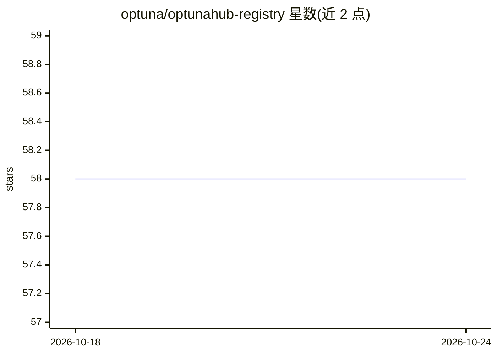

# optuna/optunahub-registry

⭐ 59 · Jupyter Notebook · MIT · 推送 2026-10-23 · [GitHub](https://github.com/optuna/optunahub-registry) · [官网](https://hub.optuna.org) · 组织维护

**Optuna 优化包的共享与发现注册表服务**

Optuna 官方组织的注册表仓库：为用户自定义 Optuna 包（采样器、剪枝器、可视化等类别）提供集中注册与发现平台，配套 optunahub Python 库（通过 load_module 从注册表加载模块）、optunahub-registry（本仓库）与 optunahub-web 网站前端三个仓库。贡献流程包括复制模板目录、填写 README、运行 pre-commit 格式化并用 optunahub.load_module 验证可加载性。面向希望共享或复用黑盒优化组件的 Optuna 用户与开发者。

## 筛选速览

| 维度 | 判定 | 备注 |
|---|---|---|
| AI 角色 | `ai-ecosystem` | LLM/agent 周边工具 |
| 许可风险 | `permissive` | MIT |
| 部署形态 | `library` | 以包/库形式分发 |
| 模型依赖 | — | README 未给出锁定关系 |
| 硬件要求 | — | 无带数字的原话,不猜 |
| 安装摩擦 | `low` | 无编译、无系统依赖或容器化 |
| 成熟度 | — | 结构信号不足 |

## 能力要点

- 集中注册与发现用户自定义 Optuna 包（pruners/samplers/visualization 等类别）
- 提供包模板目录与贡献 TODO 清单
- 通过 optunahub.load_module 从注册表按 category/package 加载模块
- 三仓库结构：optunahub 库 / registry / web 前端

## 适用场景

- 把自己写的采样器或剪枝器发布给 Optuna 社区复用
- 发现他人贡献的黑盒优化算法包并在实验中使用
- 按贡献模板规范提交自己的 Optuna 扩展包

## 场景标签

 · 领域:机器学习/优化基础设施

## 证据(README 行号)

> L11: OptunaHub Registry is a registry service for sharing and discovering user-defined Optuna packages. It provides a pl
> L22: - optunahub

## 星数曲线

2026-10-18 58 → 2026-10-24 58（+0）

---
*卡片 v1 · prompt 1.4 · 生成 2026-10-24 · 置信度 mid · 依据 README sha `ad88d3b7afc2` · [字段定义](../../DATASET.md)*
