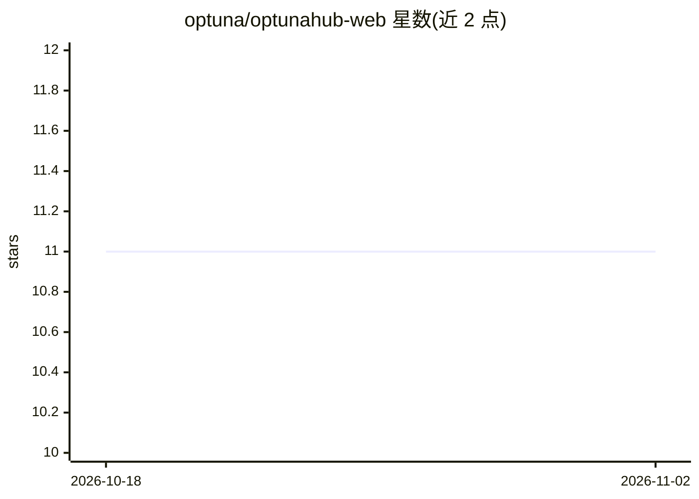

# optuna/optunahub-web

⭐ 11 · HTML · MIT · 推送 2026-10-30 · [GitHub](https://github.com/optuna/optunahub-web) · [官网](https://hub.optuna.org) · 组织维护

**OptunaHub 黑盒优化包注册平台的前端网站**

OptunaHub Registry 的前端仓库：提供 OptunaHub 网站的 Web 界面，OptunaHub 是一个收录与分发黑盒优化（含 Optuna 算法与基准）包的平台。使用 OptunaHub 需安装 optunahub 库；注册自有包则需向 optunahub-registry 仓库贡献。README 提供了引用的 OptunaHub 论文（ozaki2026optunahub）的 BibTeX 条目。本仓库仅包含前端代码，不含库或注册数据本身。

## 筛选速览

| 维度 | 判定 | 备注 |
|---|---|---|
| AI 角色 | `ai-ecosystem` | LLM/agent 周边工具 |
| 许可风险 | `permissive` | MIT |
| 部署形态 | `None` |  |
| 模型依赖 | — | README 未给出锁定关系 |
| 硬件要求 | — | 无带数字的原话,不猜 |
| 安装摩擦 | `low` | 无编译、无系统依赖或容器化 |
| 成熟度 | — | 结构信号不足 |

## 能力要点

- OptunaHub 网站的前端仓库
- 配套 optunahub 库供安装使用，向 optunahub-registry 贡献可注册包
- 提供平台论文（ozaki2026optunahub）的引用格式

## 适用场景

- 浏览与发现 OptunaHub 上的优化算法与基准包
- 为黑盒优化实验寻找可复用的算法实现

## 场景标签

 · 领域:机器学习/优化基础设施

## 证据(README 行号)

> L5: This is the repository of the frontend for OptunaHub.
> L8: - To use OptunaHub, please install the optunahub library.
> L10: - To register your package with OptunaHub, please contribute to the optunahub-registry.

## 星数曲线

2026-10-18 11 → 2026-11-02 11（+0）

---
*卡片 v1 · prompt 1.4 · 生成 2026-11-01 · 置信度 mid · 依据 README sha `c84812e6523f` · [字段定义](../../DATASET.md)*
