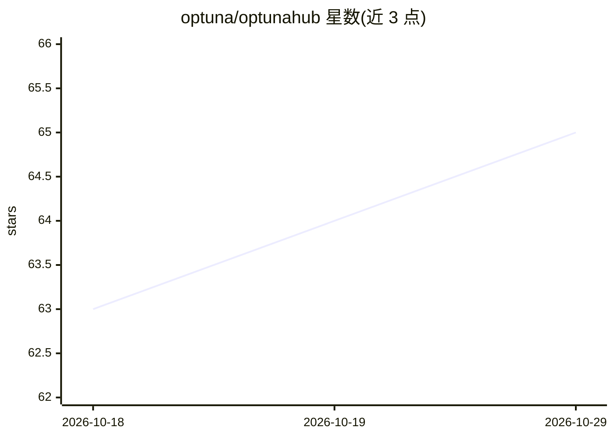

# optuna/optunahub

⭐ 65 · Python · MIT · 推送 2026-10-28 · [GitHub](https://github.com/optuna/optunahub) · [官网](https://hub.optuna.org) · 组织维护

**使用与发布 OptunaHub 优化算法包的 Python 客户端库**

OptunaHub 是基于 Optuna 的黑盒优化算法共享平台，本仓库为其官方 Python 客户端库：通过 optunahub.load_module 加载平台上发布的优化算法、可视化与基准问题（Benchmark）包，供 Optuna 用户在代码中直接调用；用户也可向 optunahub-registry 仓库提交 PR 注册自己的算法实现。平台由 optunahub、optunahub-registry、optunahub-web 三个仓库组成，支持 Linux/macOS/Windows，经 pip 与 conda-forge 安装，MIT 许可，相关论文发表于 JMLR。

## 筛选速览

| 维度 | 判定 | 备注 |
|---|---|---|
| AI 角色 | `ai-ecosystem` | LLM/agent 周边工具 |
| 许可风险 | `permissive` | MIT |
| 部署形态 | `library` | 以包/库形式分发 |
| 模型依赖 | — | README 未给出锁定关系 |
| 硬件要求 | — | 无带数字的原话,不猜 |
| 安装摩擦 | `low` | 无编译、无系统依赖或容器化 |
| 成熟度 | — | 结构信号不足 |

## 能力要点

- load_module 一行加载平台上发布的优化算法包
- 支持注册用户自己的算法实现并发布给全球 Optuna 用户
- 覆盖算法、结果可视化与 Benchmark 基准问题
- 相关论文发表于 JMLR（2026 年 9 月）

## 适用场景

- 在 Optuna 项目中直接调用平台上的优化算法
- 将自己的优化算法实现发布给其他 Optuna 用户
- 使用平台提供的基准问题与可视化工具做优化分析

## 场景标签

 · 领域:机器学习/优化工具生态

## 证据(README 行号)

> L15: *OptunaHub* is a platform for black-box optimization. On the basis of Optuna, a powerful and flexible black-box opt
> L17: This is the repository of the optunahub Python Library to use packages published in OptunaHub. If you would like to

## 星数曲线

2026-10-18 63 → 2026-10-29 65（+2）

---
*卡片 v1 · prompt 1.4 · 生成 2026-10-24 · 置信度 high · 依据 README sha `23834bc0389b` · [字段定义](../../DATASET.md)*
