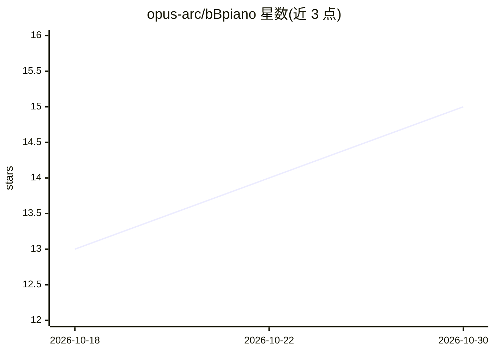

# opus-arc/bBpiano

⭐ 15 · C++ · NOASSERTION · 推送 2026-10-27 · [GitHub](https://github.com/opus-arc/bBpiano) · [官网](https://opus-arc.github.io/bBpiano/) · 个人维护 · 中文 README

**受 Pianoteq 启发的物理建模钢琴合成引擎（研发阶段）**

由 bBSonicLab 独立开展的物理建模钢琴合成项目，核心是一个以物理建模方式合成钢琴声音的引擎，目标是在轻量与实时响应的前提下呈现声学钢琴的演奏表现。项目引用 Chabassier、Bank、Tominaga 等钢琴声学与物理建模研究作为理论基础，采用数字波导、模态合成等方向的方法，并在物理保真度与计算效率之间权衡。目前处于积极研发与架构重构阶段，公开更新频率可能较低；macOS 可通过 Homebrew 安装 bBpiano-L。评估环节将合成音频与 MAESTRO Yamaha Disklavier 数据集对比，基线含 Pianoteq 8 与 SF2 采样钢琴。

## 筛选速览

| 维度 | 判定 | 备注 |
|---|---|---|
| AI 角色 | `ai-native` | 本体是模型或模型工具 |
| 许可风险 | `none` | NOASSERTION |
| 部署形态 | `None` |  |
| 模型依赖 | — | README 未给出锁定关系 |
| 硬件要求 | — | 无带数字的原话,不猜 |
| 安装摩擦 | `low` | 无编译、无系统依赖或容器化 |
| 成熟度 | `idea` | |

## 能力要点

- 物理建模钢琴合成引擎（非采样式）
- 以数字波导、模态合成等物理建模研究为基础
- 使用 MAESTRO Yamaha Disklavier 数据集做合成质量评估
- macOS 经 Homebrew 提供 bBpiano-L 安装

## 适用场景

- 在计算机上实时合成物理建模的钢琴声音
- 研究钢琴声学建模与物理合成方法
- 对比物理建模与采样式合成钢琴的音质

## 场景标签

 · 领域:音频DSP/计算机音乐

## 证据(README 行号)

> L58: bBpiano is a physical modeling piano synthesis project inspired by Pianoteq 9, currently in an active research and 
> L196: To evaluate the acoustic realism and synthesis quality of bBpiano, we compare synthesized audio against reference 

## 星数曲线

2026-10-18 13 → 2026-10-30 15（+2）

---
*卡片 v1 · prompt 1.4 · 生成 2026-10-30 · 置信度 low · 依据 README sha `1b986171a916` · [字段定义](../../DATASET.md)*
