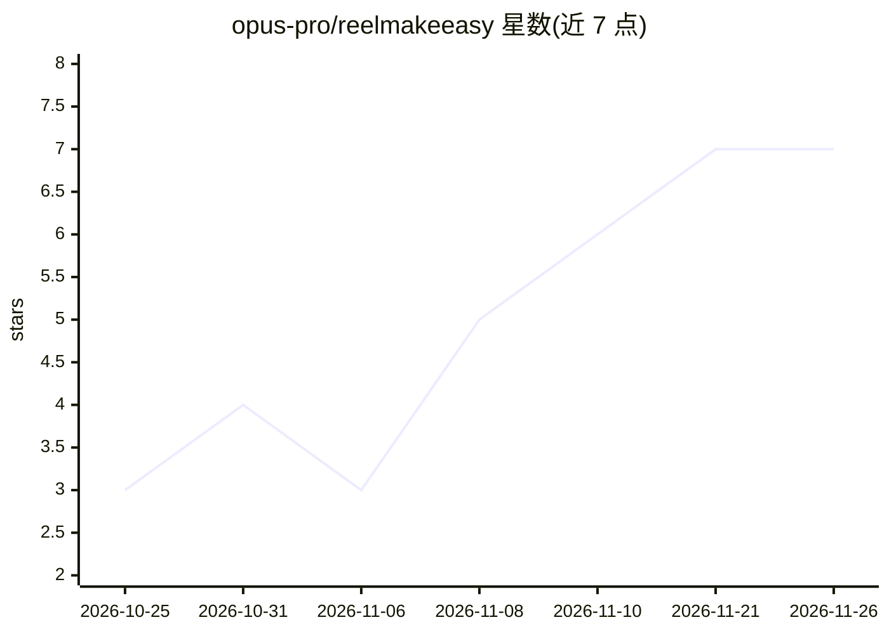

# opus-pro/reelmakeeasy

⭐ 7 · TypeScript · AGPL-3.0 · 推送 2026-11-23 · [GitHub](https://github.com/opus-pro/reelmakeeasy) · [官网](https://open.opus.pro/reelmakeeasy/) · 组织维护

**自托管的 AI 竖屏短视频生成器，由你的编程 Agent 指挥在本机生成**

自托管的 AI 短视频生成应用，把一句话想法、故事或脚本转成带旁白的 9:16 竖屏成片，覆盖场景规划、旁白撰写、关键帧与运动生成、配乐、逐词字幕及 MP4 渲染，面向 YouTube Shorts、TikTok、Instagram Reels。需 Node.js 22+、pnpm 与 FFmpeg 7+，内嵌 MongoDB，图像/语音等生成通过用户自备的 fal.ai 或 Gemini key 计费；本地免费语音（Kokoro、Qwen3-TTS）与本地字幕对齐（Whisper）可选。通过 Claude Code/Codex 等编程 Agent 或 CLI 安装运行，Web 界面监听 127.0.0.1。

## 筛选速览

| 维度 | 判定 | 备注 |
|---|---|---|
| AI 角色 | `ai-native` | 本体是模型或模型工具 |
| 许可风险 | `viral` | AGPL-3.0 |
| 部署形态 | `self-host` | docker 或自建部署 |
| 模型依赖 | — | README 未给出锁定关系 |
| 硬件要求 | `gpu-24g` | |
| 安装摩擦 | `low` | 无编译、无系统依赖或容器化 |
| 成熟度 | — | 结构信号不足 |

## 能力要点

- AI 导演流水线：剧本、旁白、关键帧、配乐、逐词字幕到 MP4 渲染
- Agent 模式由用户已有的 Codex 或 Claude Code 驱动，含 skills/ 技能库与 AGENTS.md 安装手册
- 本地免费语音 Kokoro/Qwen3-TTS 与本地 Whisper 字幕对齐，可选 GPU/CPU 后端
- 多种格式：25 种视觉风格的叙事视频、Motion Reels、Claude 代码动画、Beat loop、榜单视频、社媒发布

## 适用场景

- 一句话想法生成 30-60 秒带旁白的竖屏短视频
- 在自家电脑上本地渲染，省去云端视频服务费用
- 批量制作榜单/Beat loop 等固定格式短片并定时发布到社媒
- 给已有视频换剪辑、旁白、字幕或配乐而不重做全片

## 场景标签

`视频生成` `语音合成` · 领域:内容生成

## 证据(README 行号)

> L18: ReelMakeEasy is a self-hosted AI video generator. It turns a story, a script or a one-line idea into a finished, na
> L28: The agent checks your computer, asks which video key you have (fal or Gemini), installs the free local voices and c
> L135: ReelMakeEasy is built to be driven by AI coding agents. Agent mode runs your own Codex or Claude Code with ReelMak

## 星数曲线

2026-10-25 3 → 2026-11-26 7（+4）

---
*卡片 v1 · prompt 1.4 · 生成 2026-11-20 · 置信度 mid · 依据 README sha `5ed74def9366` · [字段定义](../../DATASET.md)*
