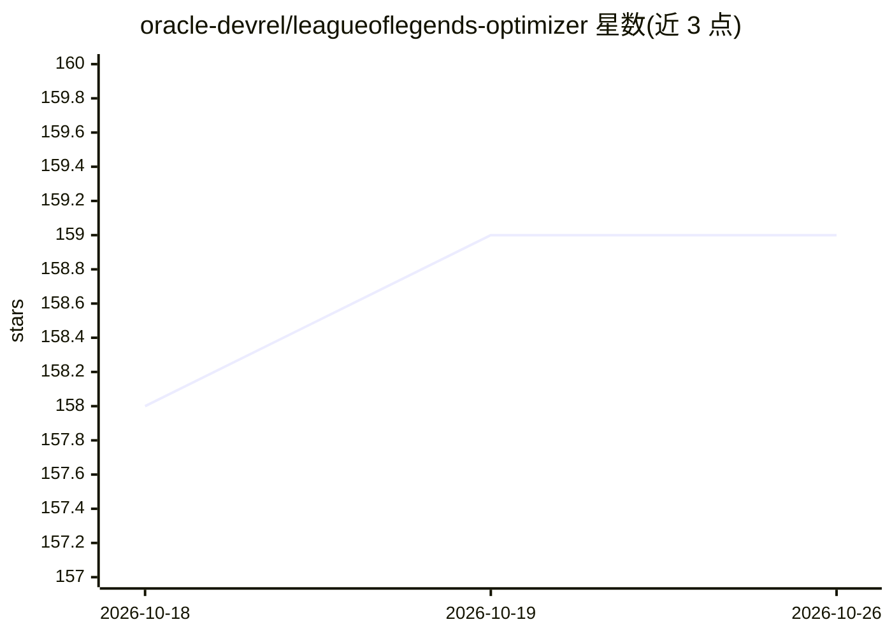

# oracle-devrel/leagueoflegends-optimizer

⭐ 159 · Jupyter Notebook · UPL-1.0 · 推送 2026-02-12 · [GitHub](https://github.com/oracle-devrel/leagueoflegends-optimizer) · 组织维护

**教学项目：用 Riot API 与机器学习实时预测英雄联盟胜率**

Oracle DevRel 出品的教学型 Hands-On Labs 项目：通过 Riot Games 官方 API 提取职业玩家与对局数据，存入 Oracle Autonomous JSON Database，用 scikit-learn 与 AutoGluon 训练表格模型预测玩家胜率。实时路径为：游戏机上运行的 producer 请求本机 2999 端口 Live Client Data API，经 RabbitMQ 消息队列发送给任意机器上的 consumer，用轻量 AutoGluon 模型（5 万行训练）做出实时胜负预测。运行需 Oracle Instant Client、Riot API key 与自建 config.yaml；作者声明轻量模型精度有限，演示对局为训练工具人机。以源码（python league.py）形式运行，训练在独立 notebook 完成。

## 筛选速览

| 维度 | 判定 | 备注 |
|---|---|---|
| AI 角色 | `ai-native` | 本体是模型或模型工具 |
| 许可风险 | `viral` | UPL-1.0 |
| 部署形态 | `None` |  |
| 模型依赖 | — | README 未给出锁定关系 |
| 硬件要求 | — | 无带数字的原话,不猜 |
| 安装摩擦 | `low` | 无编译、无系统依赖或容器化 |
| 成熟度 | — | 结构信号不足 |

## 能力要点

- Riot Games API 数据提取（玩家/对局/实时对局三种模式）
- AutoGluon 表格模型预测对局胜负概率
- RabbitMQ producer/consumer 架构，将预测负载与游戏机器分离
- Oracle Autonomous JSON Database 存储数据

## 适用场景

- 跟着文章系列学习数据工程与机器学习全流程
- 在对局中获取实时胜负概率预测
- 学习消息队列在 ML 推理架构中的应用

## 场景标签

`教程课程` · 领域:学习与行业

## 证据(README 行号)

> L31: League of Legends optimizer is a project created for educational purposes that uses Riot Games' API to make real-ti
> L144: When we join a League of Legends game, the League process opens port 2999. We'll use this to our advantage and we'

## 星数曲线

2026-10-18 158 → 2026-10-26 159（+1）

---
*卡片 v1 · prompt 1.4 · 生成 2026-10-22 · 置信度 high · 依据 README sha `7d649d2887e1` · [字段定义](../../DATASET.md)*
