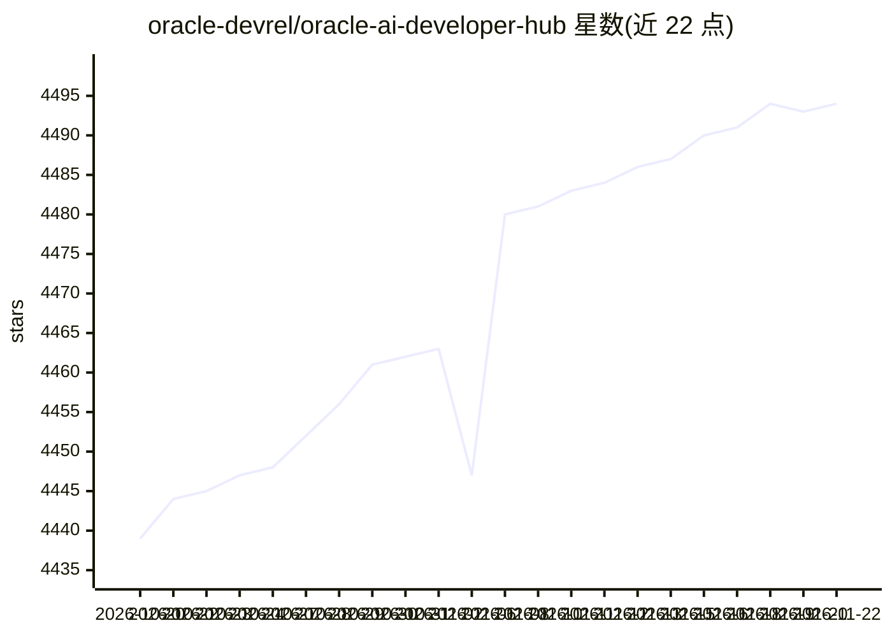

# oracle-devrel/oracle-ai-developer-hub

⭐ 4,494 · Jupyter Notebook · 推送 2026-11-20 · [GitHub](https://github.com/oracle-devrel/oracle-ai-developer-hub) · [官网](https://oracle-devrel.github.io/oracle-ai-developer-hub/) · 组织维护

**面向 AI 开发者的 Oracle AI 数据库与 OCI 资源集**

Oracle DevRel 维护的技术资源仓库，按三类组织：/apps 收录十余个完整示例应用（源码、部署配置、文档），/notebooks 提供 Jupyter 教程，/guides 收录会议演讲与参考资料。主题围绕以 Oracle AI Database 26ai 作为 AI 应用的统一底座：向量检索、混合搜索、agent 记忆、RAG、MCP 服务器等，配合 OCI 服务与 LangChain/LangGraph/OpenAI Agents SDK 等框架。内容以示例与教程为主，覆盖数据库内嵌 ONNX 嵌入、DBMS_VECTOR_CHAIN、oracleagentmemory 包等特性的用法演示。

## 筛选速览

| 维度 | 判定 | 备注 |
|---|---|---|
| AI 角色 | `ai-knowledge` | 知识聚合/清单类 |
| 许可风险 | `none` | — |
| 部署形态 | `library` | 以包/库形式分发 |
| 模型依赖 | local-ok | 支持本地模型 |
| 硬件要求 | — | 无带数字的原话,不猜 |
| 安装摩擦 | `low` | 无编译、无系统依赖或容器化 |
| 成熟度 | — | 结构信号不足 |

## 能力要点

- /apps 含 12 个端到端示例应用，含源码与部署配置
- /notebooks 提供 RAG、agent 记忆、迁移等教程笔记本
- /guides 收录 agent 架构与记忆工程会议材料
- oracleagentmemory 包以 Oracle AI Database 作 agent 统一记忆核

## 适用场景

- 学习用 Oracle AI Database 构建 RAG 与多 agent 应用
- 参考示例把 agent 记忆落到单一数据库
- 了解 Oracle AI Database 与各 agent 框架的集成方式

## 场景标签

`RAG` `Agent 记忆` `教程课程` · 领域:Agent 开发

## 证据(README 行号)

> L3: This repository contains technical resources to help AI Developers and Engineers build AI applications, agents, and 
> L11: Applications and reference implementations demonstrating how to build AI-powered solutions with Oracle technologies

## 星数曲线

2026-10-20 4,439 → 2026-11-22 4,494（+55）

---
*卡片 v1 · prompt 1.4 · 生成 2026-11-22 · 置信度 mid · 依据 README sha `5de6758bb6cb` · [字段定义](../../DATASET.md)*
