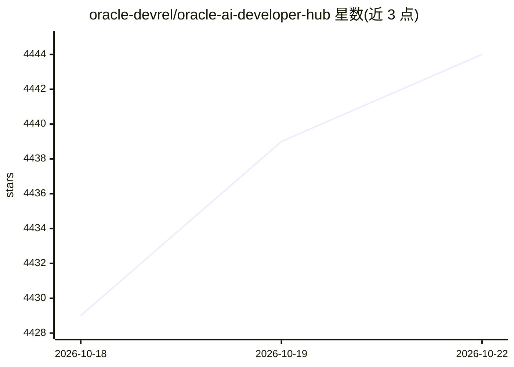

# oracle-devrel/oracle-ai-developer-hub

⭐ 4,444 · Jupyter Notebook · 推送 2026-10-21 · [GitHub](https://github.com/oracle-devrel/oracle-ai-developer-hub) · [官网](https://oracle-devrel.github.io/oracle-ai-developer-hub/) · 组织维护

**Oracle 官方 AI 开发者资源库：示例应用、教程笔记本与架构指南**

Oracle DevRel 维护的技术资源集合，面向基于 Oracle AI Database 与 OCI 构建 AI 应用、agent 与系统的开发者。内容分四类：完整参考应用（RAG、agent、文档处理、MCP 可视化服务器等十余个）、Jupyter 教程笔记本（模型开发、向量搜索、agent 记忆、多云部署）、企业级 agent 架构与记忆工程指南（会议演讲材料），以及 oracleagentmemory 包的专项笔记本（含基准测试与 OpenAI/Claude/LangGraph 框架示例）。各条目含源码、部署配置与文档。

## 筛选速览

| 维度 | 判定 | 备注 |
|---|---|---|
| AI 角色 | `ai-knowledge` | 知识聚合/清单类 |
| 许可风险 | `none` | — |
| 部署形态 | `library` | 以包/库形式分发 |
| 模型依赖 | local-ok | 支持本地模型 |
| 硬件要求 | — | 无带数字的原话,不猜 |
| 安装摩擦 | `low` | 无编译、无系统依赖或容器化 |
| 成熟度 | — | 结构信号不足 |

## 能力要点

- 十余个端到端参考应用（RAG、多 agent、文档处理、MCP 服务器）
- 覆盖 LangChain/LangGraph/Ollama/OpenAI 等技术栈的教程笔记本
- Oracle AI Database 作为 agent 统一记忆层的专项笔记本与基准测试
- 会议演讲级 agent 架构与记忆工程指南

## 适用场景

- 搭建基于 Oracle AI Database 的 RAG 或 agent 应用时寻找参考实现
- 学习 agent 记忆工程架构与推理模式
- 比较多云环境下 Oracle AI Database 的接入方式

## 场景标签

`教程课程` `RAG` `Agent 记忆` `精选清单` · 领域:Agent 开发

## 证据(README 行号)

> L3: This repository contains technical resources to help AI Developers and Engineers build AI applications, agents, and 
> L7: This repository is organized into several key areas:
> L9: ### 📱 **Apps** (`/apps`)

## 星数曲线

2026-10-18 4,429 → 2026-10-22 4,444（+15）

---
*卡片 v1 · prompt 1.4 · 生成 2026-10-20 · 置信度 mid · 依据 README sha `adc3ec4568ae` · [字段定义](../../DATASET.md)*
