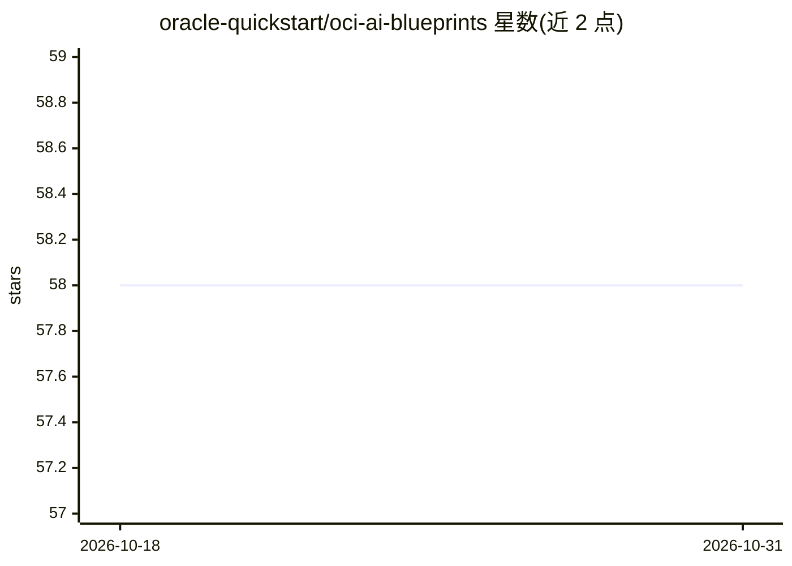

# oracle-quickstart/oci-ai-blueprints

⭐ 58 · HCL · UPL-1.0 · 推送 2026-04-23 · [GitHub](https://github.com/oracle-quickstart/oci-ai-blueprints) · 组织维护

**在自有人 OCI/OKE 集群上一键部署生成式 AI 工作负载的平台**

Oracle 提供的无代码部署平台，将生成式 AI 工作负载部署到租户内的 Kubernetes Engine（OKE）集群，提供硬件选型建议、预打包软件栈与开箱即用的监控、日志和自动伸缩。内置十余个蓝图：vLLM 推理（含多节点 RDMA、MIG、KEDA 自动伸缩）、Llama Stack（vLLM+ChromaDB+Postgres）、LoRA 微调与 GPU 性能基准测试、基于 Ollama 的 CPU 推理、任务队列等。通过按钮一键安装到自有集群，面向使用 Oracle Cloud 的企业用户。

## 筛选速览

| 维度 | 判定 | 备注 |
|---|---|---|
| AI 角色 | `ai-ecosystem` | LLM/agent 周边工具 |
| 许可风险 | `viral` | UPL-1.0 |
| 部署形态 | `None` |  |
| 模型依赖 | local-ok | 支持本地模型 |
| 硬件要求 | — | 无带数字的原话,不猜 |
| 安装摩擦 | `low` | 无编译、无系统依赖或容器化 |
| 成熟度 | — | 结构信号不足 |

## 能力要点

- vLLM 多种推理蓝图：自动伸缩、多节点 RDMA、MIG 分片 GPU
- Llama Stack 端到端 GenAI 运行时（推理/RAG/遥测统一 API）
- LoRA 微调（含 HuggingFace 模型）与 MLCommons 基准测试蓝图
- 监控、日志、自动伸缩随蓝图预配置

## 适用场景

- 在自有 OCI 租户和 GPU 资源上快速部署 LLM 推理服务
- 为 Llama 系列模型搭建自动伸缩的多节点推理集群
- 运行 LoRA 微调与 GPU 性能基准测试
- 用 Ollama 在 CPU 上测试小模型推理

## 场景标签

`推理引擎` `微调` `RAG` · 领域:知识与检索

## 证据(README 行号)

> L5: OCI AI Blueprints is a streamlined, no-code solution for deploying and managing Generative AI workloads on Kubernete
> L25: After you install OCI AI Blueprints to an OKE cluster in your tenancy, you can deploy these pre-built blueprints:

## 星数曲线

2026-10-18 58 → 2026-10-31 58（+0）

---
*卡片 v1 · prompt 1.4 · 生成 2026-10-24 · 置信度 high · 依据 README sha `372161541ef4` · [字段定义](../../DATASET.md)*
