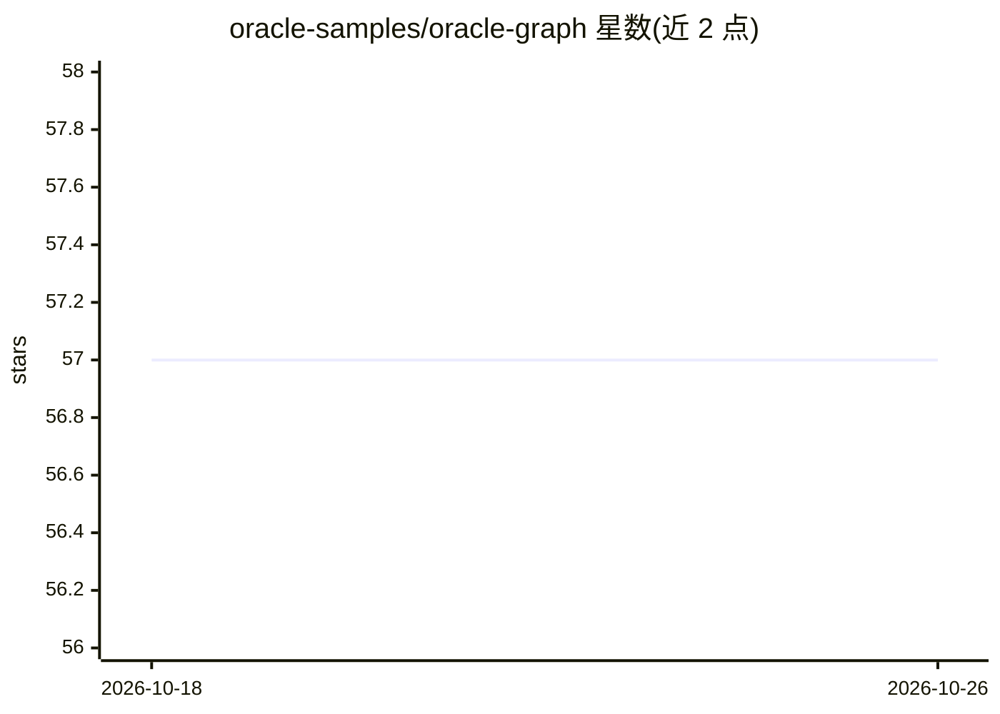

# oracle-samples/oracle-graph

⭐ 57 · PLSQL · NOASSERTION · 推送 2026-07-28 · [GitHub](https://github.com/oracle-samples/oracle-graph) · [官网](https://www.oracle.com/database/integrated-graph-database/) · 组织维护

**Oracle Graph 官方示例库：属性图/RDF/知识图与 GraphRAG 演示**

Oracle 官方维护的 Oracle Graph 示例与演示仓库，按 property-graph、knowledge-graph、rdf、shared 四个目录组织：提供 26ai 与 19c 两条入门路径、80+ 内置图算法示例（PageRank、Louvain、Dijkstra 等）、GraphRAG 与知识图演示，以及从非结构化文本自动构建知识图的示例。运行需 Oracle AI Database 26ai 或 Oracle Database 19c 并启用 Oracle Graph 组件，部分示例需 Python/Jupyter。

## 筛选速览

| 维度 | 判定 | 备注 |
|---|---|---|
| AI 角色 | `ai-knowledge` | 知识聚合/清单类 |
| 许可风险 | `none` | NOASSERTION |
| 部署形态 | `None` |  |
| 模型依赖 | — | README 未给出锁定关系 |
| 硬件要求 | — | 无带数字的原话,不猜 |
| 安装摩擦 | `low` | 无编译、无系统依赖或容器化 |
| 成熟度 | — | 结构信号不足 |

## 能力要点

- 80+ 内置图算法示例（PageRank、Louvain、Dijkstra、中心性等）
- GraphRAG 演示与 VECTOR_DISTANCE 语义搜索结合图模式匹配
- SQL:2023 属性图语法与 PGQL、SPARQL 1.1/RDF/OWL 支持示例
- 26ai 与 19c 双版本入门路径及迁移指南

## 适用场景

- 在 Oracle 数据库内上手属性图与 PGQL/SQL 图查询
- 学习 GraphRAG 与知识图构建的示例
- 查找图算法与跨域图演示代码

## 场景标签

`知识图谱` `RAG` · 领域:知识与检索

## 证据(README 行号)

> L3: Property graphs, RDF graphs, Knowledge graphs, AI-ready analytics, and 80+ built-in algorithms - all native inside O
> L47: |`property-graph/`|Property graph examples, organized by database version plus algorithm samples.|
> L48: |`knowledge-graph/`|Knowledge graph and GraphRAG examples.|

## 星数曲线

2026-10-18 57 → 2026-10-26 57（+0）

---
*卡片 v1 · prompt 1.4 · 生成 2026-10-24 · 置信度 high · 依据 README sha `c95da6ad46e9` · [字段定义](../../DATASET.md)*
