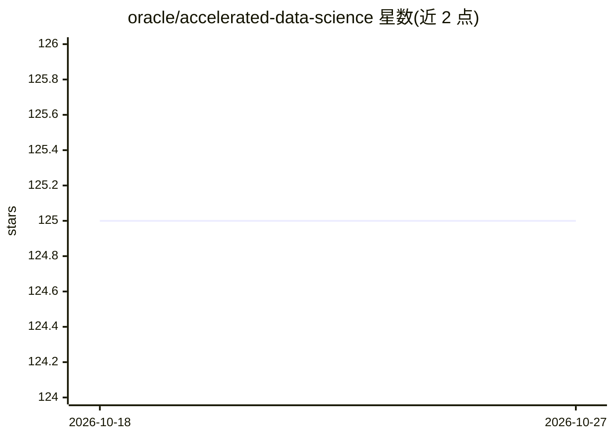

# oracle/accelerated-data-science

⭐ 125 · Python · UPL-1.0 · 推送 2026-10-23 · [GitHub](https://github.com/oracle/accelerated-data-science) · [官网](https://accelerated-data-science.readthedocs.io/) · 组织维护

**Oracle 云数据科学 Python SDK：模型全生命周期管理与 OCI 服务接口**

由 OCI Data Science 服务团队维护的 Python SDK，面向使用 Oracle 云的数据科学家，提供对 OCI Data Science、Model Catalog、Model Deployment、Jobs、ML Pipelines、Data Flow、Object Storage 等服务的 Python 接口。功能覆盖数据读取（Object Storage、Oracle RDBMS、AWS S3 等导入 Pandas）、ADSTuner 超参调优、ADSEvaluator 模型评估、模型保存与 HTTP 端点部署、Spark 分布式任务、conda 环境管理。以 pip 安装的 oracle-ads 包形式提供，带多种可选依赖模块。

## 筛选速览

| 维度 | 判定 | 备注 |
|---|---|---|
| AI 角色 | `ai-ecosystem` | LLM/agent 周边工具 |
| 许可风险 | `viral` | UPL-1.0 |
| 部署形态 | `library` | 以包/库形式分发 |
| 模型依赖 | — | README 未给出锁定关系 |
| 硬件要求 | — | 无带数字的原话,不猜 |
| 安装摩擦 | `low` | 无编译、无系统依赖或容器化 |
| 成熟度 | — | 结构信号不足 |

## 能力要点

- 从 Object Storage / Oracle RDBMS / AWS S3 等读取数据到 Pandas
- ADSTuner 超参调优与 ADSEvaluator 模型评估报告
- 模型保存到 Model Catalog 并部署为 HTTP 端点
- ML Pipelines 端到端编排与 OCI Data Flow Spark 任务

## 适用场景

- 在 Oracle 云上管理机器学习模型从训练到部署的生命周期
- 把 OCI 各数据与计算服务接入数据科学工作流
- 通过 CLI 管理数据科学 notebook 会话的 conda 环境

## 场景标签

`MLOps` · 领域:训练与推理

## 证据(README 行号)

> L5: The Oracle Accelerated Data Science (ADS) SDK is maintained by the Oracle Cloud Infrastructure (OCI) Data Science se
> L13: - Deploy models as HTTP endpoints with Model Deployment.
> L16: - Define and run an end-to-end machine learning orchestration covering all the steps of machine learning lifecycle 

## 星数曲线

2026-10-18 125 → 2026-10-27 125（+0）

---
*卡片 v1 · prompt 1.4 · 生成 2026-10-23 · 置信度 high · 依据 README sha `c3ceab0082e5` · [字段定义](../../DATASET.md)*
