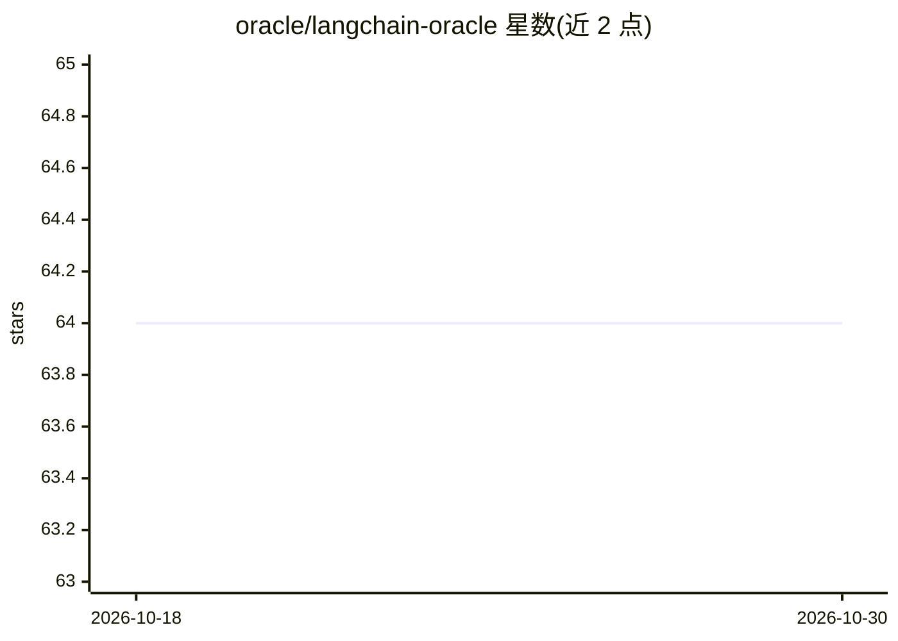

# oracle/langchain-oracle

⭐ 64 · Python · UPL-1.0 · 推送 2026-10-23 · [GitHub](https://github.com/oracle/langchain-oracle) · 组织维护

**Oracle 官方 LangChain/LangGraph 集成包：接入 OCI 生成式 AI 与 Oracle 向量检索**

Oracle 维护的官方集成仓库，提供 5 个包：langchain-oci（OCI Generative AI 聊天模型、嵌入、agent、guardrails、多模态）、langchain-oracledb（Oracle AI Vector Search 向量库、检索器、文档加载、语义缓存）、langgraph-oracledb（LangGraph 持久化 checkpointer 与长期记忆存储），及对应的 JavaScript/TypeScript 包。面向在 Oracle 云与数据库上构建 LLM 应用的开发者；需预先配置 OCI 或数据库凭据，合并并取代原 langchain-community 中的相关集成。附 samples/ 目录的分阶示例集。

## 筛选速览

| 维度 | 判定 | 备注 |
|---|---|---|
| AI 角色 | `ai-ecosystem` | LLM/agent 周边工具 |
| 许可风险 | `viral` | UPL-1.0 |
| 部署形态 | `library` | 以包/库形式分发 |
| 模型依赖 | — | README 未给出锁定关系 |
| 硬件要求 | — | 无带数字的原话,不猜 |
| 安装摩擦 | `low` | 无编译、无系统依赖或容器化 |
| 成熟度 | — | 结构信号不足 |

## 能力要点

- ChatOCIGenAI 支持流式、工具调用、结构化输出与多模态输入
- OracleVS 向量库、混合检索、语义缓存与聊天历史
- LangGraph checkpointer/store 支持同步与异步，可选向量检索做长期记忆
- Python 与 TypeScript 双语言组件

## 适用场景

- 在 OCI 上调用 Cohere/Meta/OpenAI 等模型构建聊天与 agent 应用
- 用 Oracle Database 做 RAG 的向量检索与文档处理
- 为 LangGraph agent 提供持久化状态与长期记忆

## 场景标签

`RAG` `Agent 记忆` · 领域:Agent 开发

## 证据(README 行号)

> L24: This is the official repository for the LangChain integrations with Oracle Cloud Infrastructure (OCI) and Oracle Da
> L30: |`langchain-oci`|PyPI|`pip install -U langchain-oci`|**OCI Generative AI & Data Science.** Chat models (`ChatOCIGen

## 星数曲线

2026-10-18 64 → 2026-10-30 64（+0）

---
*卡片 v1 · prompt 1.4 · 生成 2026-10-24 · 置信度 high · 依据 README sha `ca5a63ba6ad4` · [字段定义](../../DATASET.md)*
