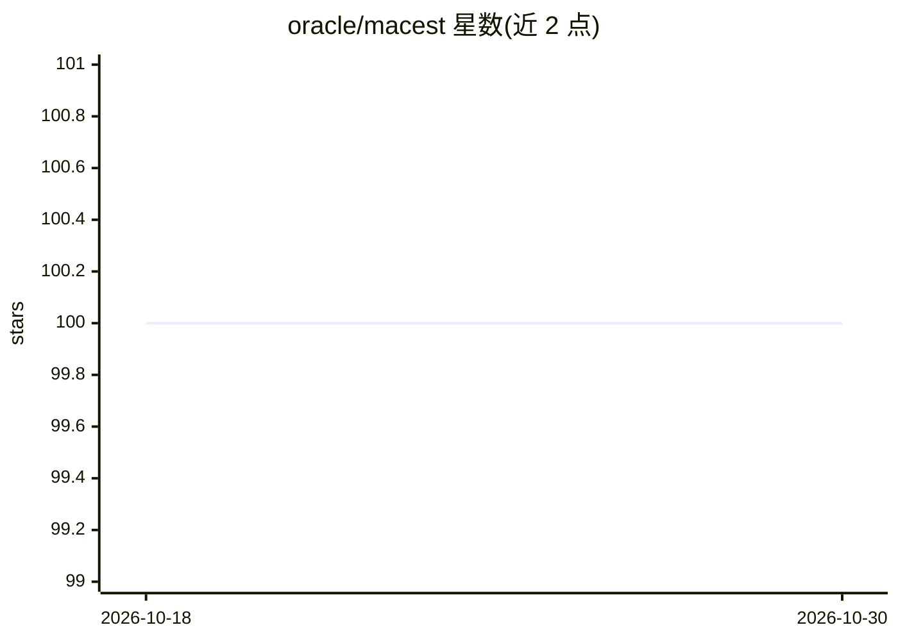

# oracle/macest

⭐ 100 · Jupyter Notebook · UPL-1.0 · 推送 2026-06-22 · [GitHub](https://github.com/oracle/macest) · 组织维护

**模型无关的置信度校准库：为监督模型预测附加可信置信估计**

Oracle 维护的 Python 库，可与任意监督学习模型（回归或分类）配合使用：回归场景输出预测区间，分类场景输出预测正确性的置信分数。机制上通过 k 近邻定义局部邻域，分别建模偶然不确定性（近邻局部准确率）与认知不确定性（新点与训练数据的相似度），经校准使 90% 置信近似等于 90% 实际正确率。方法结合 trust scores、conformal learning、高斯过程与贝叶斯建模思想，有 arXiv 论文（2021）。推荐 Python >= 3.10，pip 安装，支持稀疏数据。

## 筛选速览

| 维度 | 判定 | 备注 |
|---|---|---|
| AI 角色 | `ai-ecosystem` | LLM/agent 周边工具 |
| 许可风险 | `viral` | UPL-1.0 |
| 部署形态 | `library` | 以包/库形式分发 |
| 模型依赖 | — | README 未给出锁定关系 |
| 硬件要求 | — | 无带数字的原话,不猜 |
| 安装摩擦 | `low` | 无编译、无系统依赖或容器化 |
| 成熟度 | — | 结构信号不足 |

## 能力要点

- 回归输出置信区间、分类输出置信分数，模型无关
- 基于 k 近邻建模局部偶然与认知两类不确定性
- 经校准使置信度近似经验准确率（90% 置信≈90% 正确）
- 附 arXiv 论文与示例 notebook，支持稀疏数据

## 适用场景

- 金融、医疗等高风险场景在采纳模型预测前核验单点置信度
- 检测模型在训练数据之外的外推预测并降低其置信
- 为已有 sklearn 模型补充校准的置信估计

## 场景标签

 · 领域:机器学习/不确定性量化

## 证据(README 行号)

> L3: MACEst is a confidence estimator that can be used alongside any model (regression or
> L34: MACEst addresses this situation by providing an additional confidence estimate.

## 星数曲线

2026-10-18 100 → 2026-10-30 100（+0）

---
*卡片 v1 · prompt 1.4 · 生成 2026-10-23 · 置信度 high · 依据 README sha `fdaa67864e47` · [字段定义](../../DATASET.md)*
