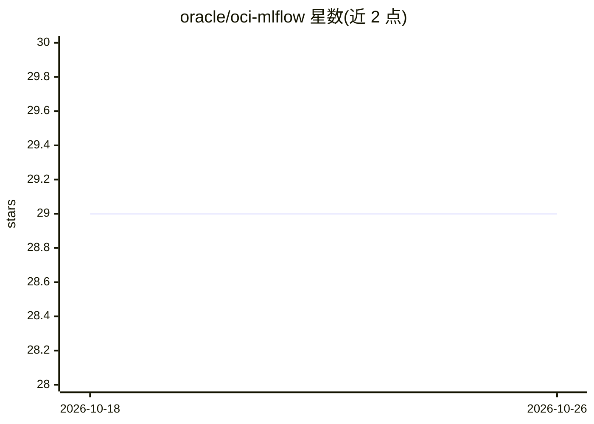

# oracle/oci-mlflow

⭐ 29 · Python · UPL-1.0 · 推送 2026-01-30 · [GitHub](https://github.com/oracle/oci-mlflow) · [官网](https://oci-mlflow.readthedocs.io) · 组织维护

**OCI 的 MLflow 插件：用 Oracle 云资源管理机器学习生命周期**

Oracle 官方提供的 MLflow 插件，将 MLflow 各功能映射到 OCI 资源：实验跟踪后端使用 Data Science Jobs、Object Storage 与 MySQL，Spark 批处理任务走 Data Flow，模型注册与部署对接 Data Science Model Catalog 和 Model Deployment。用户通过 pip 安装后，可用 mlflow run 指定 oci-datascience 后端运行项目，或用 mlflow deployments 命令将注册模型部署到 OCI。面向使用 OCI 的机器学习从业者。

## 筛选速览

| 维度 | 判定 | 备注 |
|---|---|---|
| AI 角色 | `ai-ecosystem` | LLM/agent 周边工具 |
| 许可风险 | `viral` | UPL-1.0 |
| 部署形态 | `library` | 以包/库形式分发 |
| 模型依赖 | — | README 未给出锁定关系 |
| 硬件要求 | — | 无带数字的原话,不猜 |
| 安装摩擦 | `low` | 无编译、无系统依赖或容器化 |
| 成熟度 | — | 结构信号不足 |

## 能力要点

- MLflow 实验跟踪对接 OCI Data Science Jobs、Object Storage、MySQL
- Spark 批处理任务通过 Data Flow 运行
- 模型注册与部署对接 Data Science Model Catalog / Model Deployment
- mlflow deployments 与 mlflow run --backend oci-datascience 命令支持

## 适用场景

- 在 OCI 上跟踪机器学习实验与模型产物
- 把 MLflow 注册模型部署到 OCI Data Science Model Deployment
- 用 Data Science Jobs / Data Flow 运行 MLflow 项目与 Spark 批任务

## 场景标签

 · 领域:MLOps/云机器学习

## 证据(README 行号)

> L5: The OCI MLflow plugin enables OCI users to use OCI resources to manage their machine learning use case life cycle. T
> L45: mlflow run . --experiment-name My-Experiment --backend oci-datascience --backend-config ./oci-datascience-config.js

## 星数曲线

2026-10-18 29 → 2026-10-26 29（+0）

---
*卡片 v1 · prompt 1.4 · 生成 2026-10-26 · 置信度 high · 依据 README sha `c43463cea86a` · [字段定义](../../DATASET.md)*
