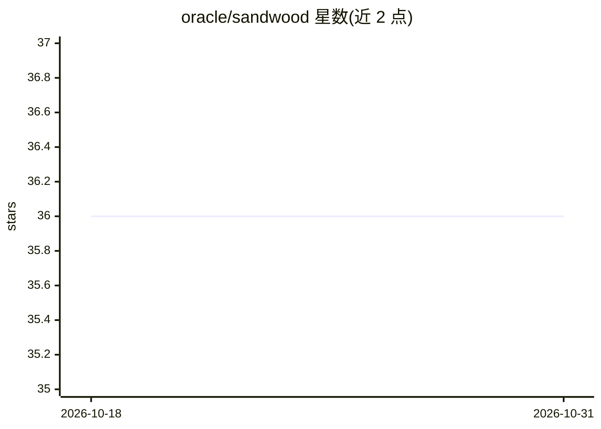

# oracle/sandwood

⭐ 36 · Java · NOASSERTION · 推送 2026-10-08 · [GitHub](https://github.com/oracle/sandwood) · 组织维护

**面向 Java 开发者的 JVM 概率编程语言与编译运行时**

Sandwood 是 Oracle 维护的基于 JVM 的概率编程语言、编译器与运行时：用类 Java 的 DSL 描述贝叶斯模型，编译生成实现全部推理操作的 Java 类，模型以 Java 对象形式嵌入更大系统中。提供命令行工具、Java 库调用和 Maven 插件三种编译途径，生成类支持 Infer Values、采样、MAP、查询对数概率等操作。语言不支持构造对象，计划未来加入 record 类型。需通过 Maven 从源码构建三个组件。

## 筛选速览

| 维度 | 判定 | 备注 |
|---|---|---|
| AI 角色 | `ai-native` | 本体是模型或模型工具 |
| 许可风险 | `none` | NOASSERTION |
| 部署形态 | `None` |  |
| 模型依赖 | — | README 未给出锁定关系 |
| 硬件要求 | — | 无带数字的原话,不猜 |
| 安装摩擦 | `low` | 无编译、无系统依赖或容器化 |
| 成熟度 | — | 结构信号不足 |

## 能力要点

- 类 Java DSL 编译为含推理实现的 Java 类
- 命令行工具 / Java 库调用 / Maven 插件三种编译方式
- 生成模型对象支持采样、MAP、对数概率查询与固定参数
- Maven 插件可在项目构建时自动编译 .sandwood 文件

## 适用场景

- Java 开发者在现有 JVM 系统中嵌入贝叶斯模型组件
- 修改模型后重编译自动更新推理代码，避免手写推理
- 通过 Maven 构建流程管理概率模型的编译

## 场景标签

 · 领域:机器学习/概率编程

## 证据(README 行号)

> L2: Sandwood is a language, compiler, and runtime for JVM based probabilistic models. It is designed to allow models to 
> L19: Probabilistic programming overcomes these issues by allowing models to be described using either an API, or a domai

## 星数曲线

2026-10-18 36 → 2026-10-31 36（+0）

---
*卡片 v1 · prompt 1.4 · 生成 2026-10-25 · 置信度 high · 依据 README sha `4607d1d61fab` · [字段定义](../../DATASET.md)*
