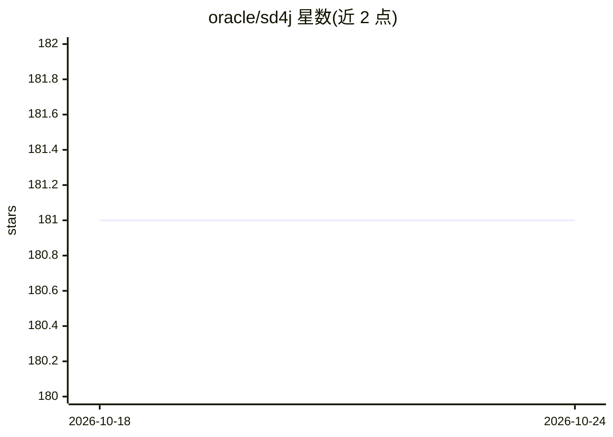

# oracle/sd4j

⭐ 181 · Java · UPL-1.0 · 推送 2026-05-06 · [GitHub](https://github.com/oracle/sd4j) · 组织维护

**Java 实现的 Stable Diffusion 推理管线，基于 ONNX Runtime**

用 Java 在 ONNX Runtime 之上实现 Stable Diffusion 文生图推理，由 C# 实现移植而来，带可反复生成的 GUI，支持负面提示词。支持 SD v1.5/v2/SDXL 模型（需先导出为 ONNX 格式），提供 LMS 与 Euler Ancestral 两种调度器；执行后端可切换 CUDA、OpenVINO，CoreML/DirectML 为实验性支持。目前仅支持 txt2img，不含 img2img、放大与 inpainting。项目定位为 ONNX Runtime Java 用法示例代码，API 不承诺稳定。

## 筛选速览

| 维度 | 判定 | 备注 |
|---|---|---|
| AI 角色 | `ai-native` | 本体是模型或模型工具 |
| 许可风险 | `viral` | UPL-1.0 |
| 部署形态 | `None` |  |
| 模型依赖 | local-ok | 支持本地模型 |
| 硬件要求 | — | 无带数字的原话,不猜 |
| 安装摩擦 | `medium` | 含编译或系统依赖之一 |
| 成熟度 | `idea` | |

## 能力要点

- Java 实现的 Stable Diffusion txt2img 推理管线，带 GUI
- 支持 SD v1.5 / SD v2 / SDXL（含 SD-Turbo）模型
- 可切换 CUDA / OpenVINO 执行后端，实验性支持 CoreML / DirectML
- SD4J 类可作为库在其他程序中调用完整生成管线

## 适用场景

- 在 Java 应用中集成 Stable Diffusion 文生图能力
- 学习 ONNX Runtime Java API 的使用与性能实践
- 带 GUI 反复调参生成图片并保存含元数据的 PNG

## 场景标签

`图像生成` `推理引擎` · 领域:内容生成

## 证据(README 行号)

> L3: This repo contains an implementation of Stable Diffusion inference running on top of ONNX Runtime,
> L15: The project supports txt2img generation, it doesn't currently implement img2img, upscaling or inpainting.
> L90: The `com.oracle.labs.mlrg.sd4j.SD4J` class provides a full image generation pipeline which can be used without the 

## 星数曲线

2026-10-18 181 → 2026-10-24 181（+0）

---
*卡片 v1 · prompt 1.4 · 生成 2026-10-22 · 置信度 high · 依据 README sha `cf3444d61c87` · [字段定义](../../DATASET.md)*
