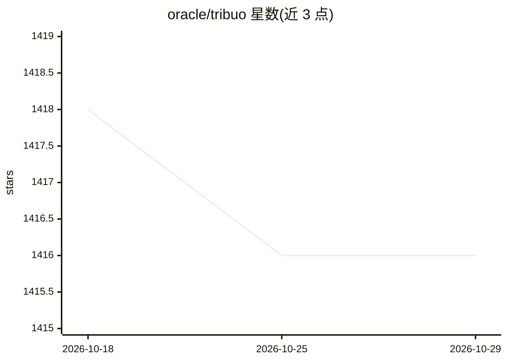

# oracle/tribuo

⭐ 1,416 · Java · Apache-2.0 · 推送 2026-05-07 · [GitHub](https://github.com/oracle/tribuo) · [官网](https://tribuo.org) · 组织维护

**Java 机器学习库：分类/回归/聚类等预测任务统一框架**

Oracle Labs 主导开发的纯 Java 机器学习库，覆盖多分类、多标签分类、多维回归、聚类与异常检测，自带数据加载、特征化、变换与评测模块。内置线性模型、随机森林、CART 等实现，并封装 TensorFlow、ONNX Runtime、XGBoost、LibSVM、LibLinear 提供 JVM 统一接口。训练器通过 OLCUT 以 xml/json 配置，模型与评测含可序列化 provenance 对象，多数模型可导出 ONNX。需 Java 8+，经 Maven Central 分发。

## 筛选速览

| 维度 | 判定 | 备注 |
|---|---|---|
| AI 角色 | `ai-native` | 本体是模型或模型工具 |
| 许可风险 | `permissive` | Apache-2.0 |
| 部署形态 | `None` |  |
| 模型依赖 | — | README 未给出锁定关系 |
| 硬件要求 | — | 无带数字的原话,不猜 |
| 安装摩擦 | `medium` | 含编译或系统依赖之一 |
| 成熟度 | — | 结构信号不足 |

## 能力要点

- 分类/回归/聚类/异常检测/多标签五类预测任务的统一接口
- 封装 TensorFlow、ONNX Runtime、XGBoost、LibSVM、LibLinear 等 JVM 库
- 模型与评测含可序列化 provenance（数据、超参、时间记录），可导出 JSON
- 多数模型可导出 ONNX 格式跨平台部署

## 适用场景

- 在 Java/JVM 项目中训练与部署传统 ML 与神经网络模型
- 需要模型溯源与可复现配置的生产环境
- 将训练好的模型导出为 ONNX 供其他语言或云服务使用

## 场景标签

`模型训练` · 领域:训练与推理

## 证据(README 行号)

> L5: Tribuo is a machine learning library in Java that
> L6: provides multi-class classification, regression, clustering, anomaly detection

## 星数曲线

2026-10-18 1,418 → 2026-10-29 1,416（-2）

---
*卡片 v1 · prompt 1.4 · 生成 2026-10-21 · 置信度 high · 依据 README sha `b55204b17e8a` · [字段定义](../../DATASET.md)*
