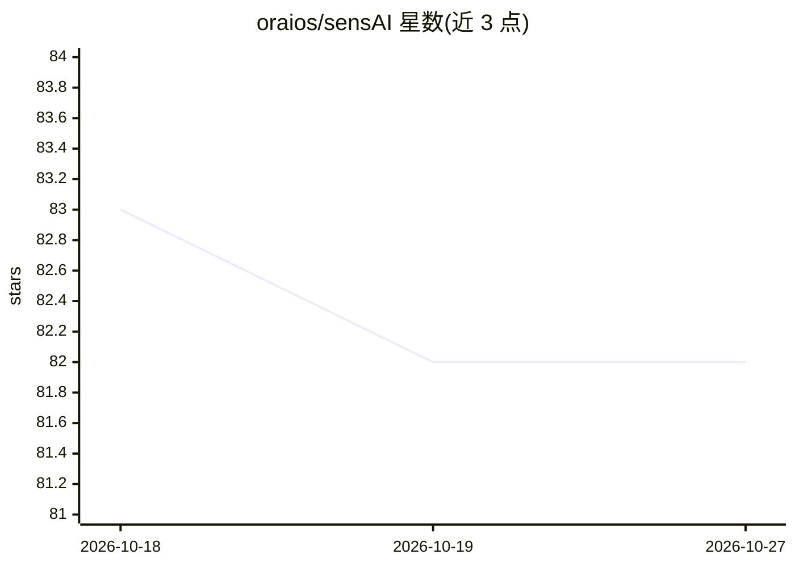

# oraios/sensAI

⭐ 82 · Python · NOASSERTION · 推送 2026-04-19 · [GitHub](https://github.com/oraios/sensAI) · [官网](https://oraios.github.io/sensAI/docs/) · 组织维护

**面向快速机器学习实验的 Python 高层工具库**

面向机器学习研究与应用开发者的 Python 库，聚焦监督/无监督学习的快速实验：提供统一接口封装 PyTorch、scikit-learn、XGBoost 等多种模型类，以 FeatureGenerator 与 DataFrameTransformer 抽象构建可组合的特征工程与模型专属数据管道，并内置模型评估、模型/特征选择、超参优化（可搭配 hyperopt/optuna）与结果跟踪（文件系统或 MLflow）的高层接口。另含聚类（含地理坐标聚类）、模拟退火等组合优化及通用工具集。声明注重持久化模型的向后兼容。

## 筛选速览

| 维度 | 判定 | 备注 |
|---|---|---|
| AI 角色 | `ai-ecosystem` | LLM/agent 周边工具 |
| 许可风险 | `none` | NOASSERTION |
| 部署形态 | `library` | 以包/库形式分发 |
| 模型依赖 | — | README 未给出锁定关系 |
| 硬件要求 | — | 无带数字的原话,不猜 |
| 安装摩擦 | `low` | 无编译、无系统依赖或容器化 |
| 成熟度 | — | 结构信号不足 |

## 能力要点

- 统一接口封装 PyTorch/scikit-learn/XGBoost 等多框架模型类
- FeatureGenerator 注册表 + DataFrameTransformer 组合特征与数据变换管道
- 高层评估/模型选择/超参优化接口，支持 MLflow 与文件系统跟踪
- 附带聚类、地理坐标聚类与模拟退火/平行回火等组合优化及通用工具集

## 适用场景

- 在同一框架下快速对比多种框架的回归/分类模型
- 模块化定义特征工程并复用于不同模型
- 记录与跟踪 ML 实验参数与结果

## 场景标签

`MLOps` · 领域:训练与推理

## 证据(README 行号)

> L9: sensAI is a high-level AI toolkit with a specific focus on **rapid
> L17:  * **A unifying interface to a wide variety of model classes across frameworks**
> L23:  sensAI supports models based on PyTorch, scikit-learn, XGBoost and

## 星数曲线

2026-10-18 83 → 2026-10-27 82（-1）

---
*卡片 v1 · prompt 1.4 · 生成 2026-10-24 · 置信度 high · 依据 README sha `9cc42c5e6ae1` · [字段定义](../../DATASET.md)*
