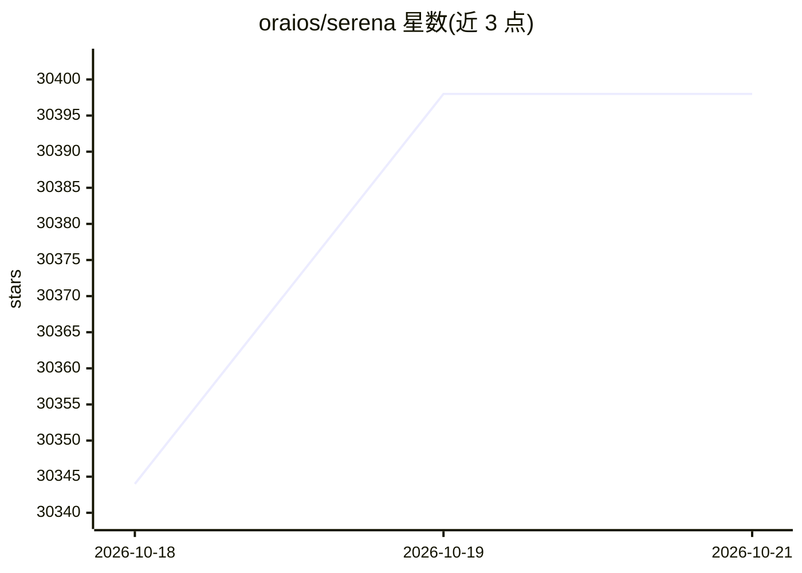

# oraios/serena

⭐ 30,398 · Python · NOASSERTION · 推送 2026-10-19 · [GitHub](https://github.com/oraios/serena) · [官网](https://oraios.github.io/serena) · 组织维护

**面向编码 Agent 的 MCP 工具集：符号级代码检索、编辑与重构**

Serena 是一个通过模型上下文协议（MCP）向 AI 编码代理提供语义代码工具的工具包：符号查找、引用查找、重命名、符号体替换、安全删除等检索/编辑/重构能力，以及记忆系统与多层 YAML 配置。语义后端有两种：默认基于 LSP 语言服务器（宣称支持 40+ 语言），或付费的 JetBrains 插件后端（含交互式调试）。本体通过 uv 安装，由终端类、IDE 类、桌面/Web 类 MCP 客户端接入；实际执行工作需依赖客户端侧 LLM。

## 筛选速览

| 维度 | 判定 | 备注 |
|---|---|---|
| AI 角色 | `ai-ecosystem` | LLM/agent 周边工具 |
| 许可风险 | `viral` | NOASSERTION |
| 部署形态 | `None` |  |
| 模型依赖 | — | README 未给出锁定关系 |
| 硬件要求 | — | 无带数字的原话,不猜 |
| 安装摩擦 | `low` | 无编译、无系统依赖或容器化 |
| 成熟度 | — | 结构信号不足 |

## 动量与使用信号

- 维护:`active` — 距上次 push 2.5 天,年发版 14,244 位贡献者
- 涨星:近 1 天 **+39**(自 20261016 起算)
- 平台:— · 协议:MCP

## 能力要点

- 符号级检索/编辑/重构工具，经 MCP 接入任意客户端
- 两种语义后端：LSP 语言服务器（默认）或付费 JetBrains 插件
- 语言服务器后端宣称支持 40+ 编程语言
- 面向长期 agent 工作流的记忆系统与多层 YAML 配置

## 适用场景

- 给 Claude Code、Codex 等 MCP 客户端的编码 agent 提供语义化代码工具
- 在大型代码库中做跨文件重命名、引用查找等重构操作
- 跨会话共享项目知识的 agent 记忆管理

## 场景标签

`Agent 记忆` · 领域:Agent 开发

## 证据(README 行号)

> L6: * Serena provides essential **semantic code retrieval, editing, refactoring and debugging tools** that are akin to a
> L8: * It integrates with any client/LLM via the model context protocol (**MCP**).
> L58: Serena can extend the functionality of your existing AI client via the **model context protocol (MCP)**.

## 星数曲线

2026-10-18 30,344 → 2026-10-21 30,398（+54）

---
*卡片 v1 · prompt 1.4 · 生成 2026-10-20 · 置信度 high · 依据 README sha `f65fc12ffaa3` · [字段定义](../../DATASET.md)*
