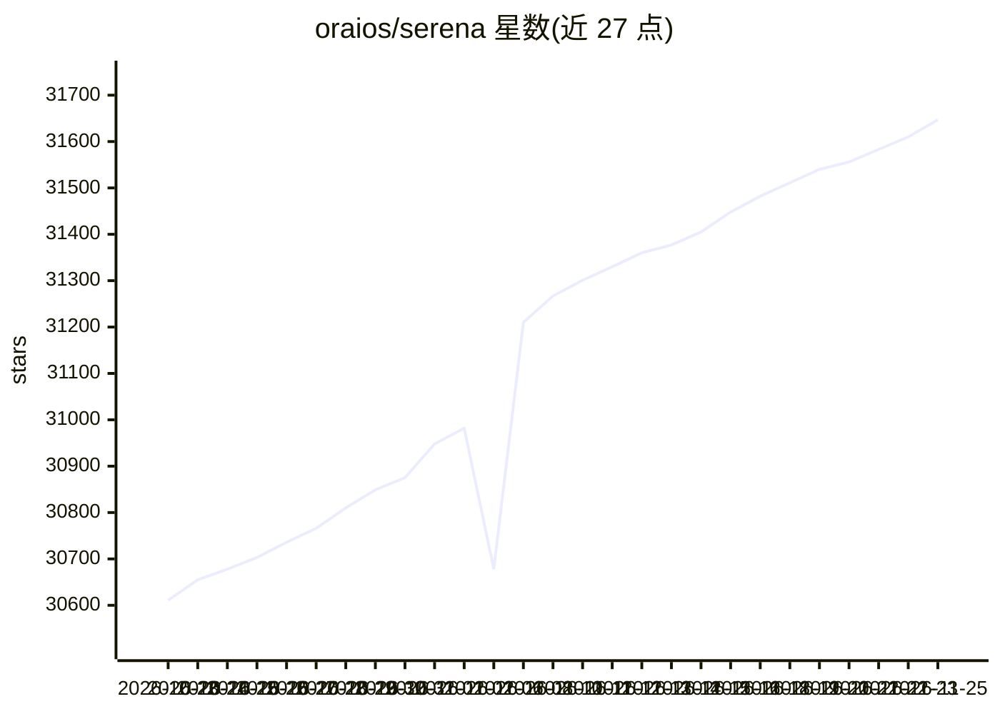

# oraios/serena

⭐ 31,647 · Python · NOASSERTION · 推送 2026-11-23 · [GitHub](https://github.com/oraios/serena) · [官网](https://oraios.github.io/serena) · 组织维护

**给编码 agent 提供语义级代码检索/编辑工具的 MCP 服务器**

Serena 通过 MCP 协议为 AI 编码客户端扩展工具集：基于语言服务器（LSP）或 JetBrains 插件两种后端，提供符号级查找、引用查找、重命名、符号编辑与调试工具，支持 40 余种编程语言，并附带跨会话记忆系统与多层 YAML 配置。README 说明 LLM 负责编排工具调用，Serena 本身不执行生成；主体以 GPL-3.0-or-later 许可，JetBrains 插件后端为付费组件。安装依赖 uv，命令为 uv tool install serena-agent。

## 筛选速览

| 维度 | 判定 | 备注 |
|---|---|---|
| AI 角色 | `ai-ecosystem` | LLM/agent 周边工具 |
| 许可风险 | `viral` | NOASSERTION |
| 部署形态 | `None` |  |
| 模型依赖 | — | README 未给出锁定关系 |
| 硬件要求 | — | 无带数字的原话,不猜 |
| 安装摩擦 | `low` | 无编译、无系统依赖或容器化 |
| 成熟度 | — | 结构信号不足 |

## 动量与使用信号

- 维护:`active` — 距上次 push 2.5 天,年发版 14,244 位贡献者
- 涨星:近 1 天 **+39**(自 20261016 起算)
- 平台:— · 协议:MCP

## 能力要点

- 基于 LSP 的符号级检索与重构工具，支持 40+ 编程语言
- 通过 MCP 协议接入 Claude Code、Codex、JetBrains IDE 等客户端
- JetBrains 插件后端提供移动/内联重构与断点调试能力
- 跨会话记忆系统与多层可组合的 YAML 配置

## 适用场景

- 让编码 agent 在大型代码库中做跨文件重命名与引用查找
- 为现有 MCP 客户端补充 IDE 级代码理解工具
- 多语言 monorepo 中的符号级导航与编辑
- 长期 agent 工作流中跨会话共享项目知识

## 场景标签

`编码 Agent` · 领域:编码与开发

## 证据(README 行号)

> L6: * Serena provides essential **semantic code retrieval, editing, refactoring and debugging tools** that are akin to a
> L58: Serena can extend the functionality of your existing AI client via the **model context protocol (MCP)**.
> L66: To connect the Serena MCP server to your client, you either

## 星数曲线

2026-10-23 30,611 → 2026-11-25 31,647（+1,036）

---
*卡片 v1 · prompt 1.4 · 生成 2026-11-22 · 置信度 high · 依据 README sha `1566420cd786` · [字段定义](../../DATASET.md)*
