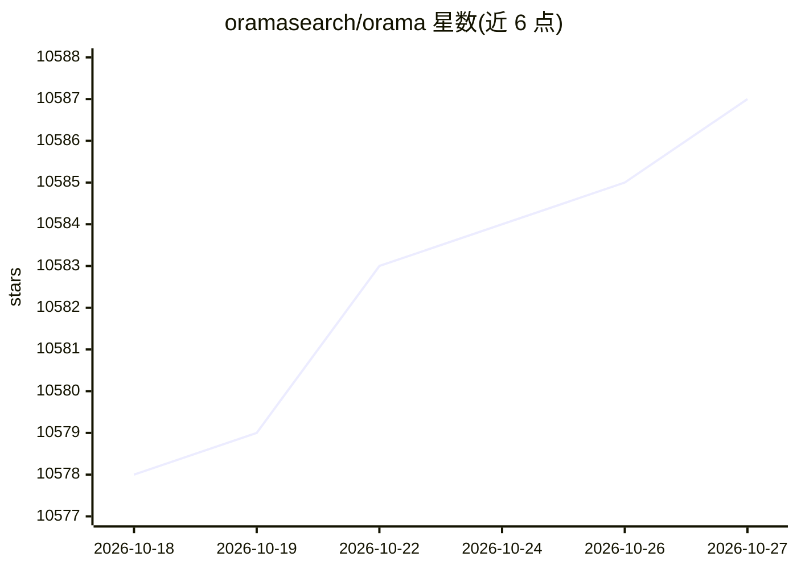

# oramasearch/orama

⭐ 10,588 · TypeScript · NOASSERTION · 推送 2026-10-18 · [GitHub](https://github.com/oramasearch/orama) · [官网](https://docs.orama.com/docs/orama-js) · 组织维护

**在浏览器/服务器/边缘运行的轻量全文+向量+混合搜索引擎库**

TypeScript 编写的嵌入式搜索引擎库，体积小于 2kb，支持全文搜索、向量搜索、混合搜索、BM25、30 种语言的词干化与分词、地理搜索、分面过滤与插件系统。向量搜索需在搜索时提供文本嵌入，可通过官方 plugin-embeddings 插件配合 TensorFlowJS 后端生成嵌入，或经 Secure Proxy 插件调用 OpenAI 嵌入模型。自 v3.0.0 起支持基于 OpenAI API 构建类 ChatGPT 的聊天会话体验。通过 npm 安装，也可经浏览器 module 或 Deno CDN 引入。

## 筛选速览

| 维度 | 判定 | 备注 |
|---|---|---|
| AI 角色 | `ai-ecosystem` | LLM/agent 周边工具 |
| 许可风险 | `none` | NOASSERTION |
| 部署形态 | `library` | 以包/库形式分发 |
| 模型依赖 | — | README 未给出锁定关系 |
| 硬件要求 | — | 无带数字的原话,不猜 |
| 安装摩擦 | `low` | 无编译、无系统依赖或容器化 |
| 成熟度 | — | 结构信号不足 |

## 能力要点

- 全文/向量/混合三种搜索模式，支持 BM25 与拼写容错
- 10 种数据类型含 geopoint 与 vector[<size>]
- 官方插件覆盖嵌入生成、OpenAI Secure Proxy、数据持久化等
- 可在浏览器、Node、Deno 与边缘网络运行

## 适用场景

- 为网站或应用内嵌全文与向量混合搜索
- 配合嵌入插件构建本地向量检索
- 基于 OpenAI API 搭建类 ChatGPT 的搜索问答体验

## 场景标签

`向量数据库` · 领域:知识与检索

## 证据(README 行号)

> L78: # Vector and Hybrid Search Support
> L102: # RAG and Chat Experiences with Orama
> L104: Since `v3.0.0`, Orama allows you to create your own ChatGPT/Perplexity/SearchGPT-like experience. You will need to

## 星数曲线

2026-10-18 10,578 → 2026-10-27 10,587（+9）

---
*卡片 v1 · prompt 1.4 · 生成 2026-10-20 · 置信度 high · 依据 README sha `b5cd064e4abd` · [字段定义](../../DATASET.md)*
