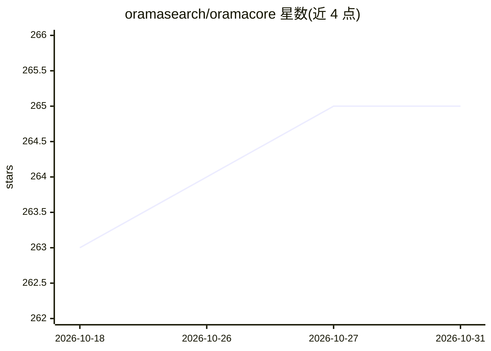

# oramasearch/oramacore

⭐ 265 · Rust · AGPL-3.0 · 推送 2026-10-24 · [GitHub](https://github.com/oramasearch/oramacore) · [官网](https://docs.orama.com/docs/cloud) · 组织维护

**带全文检索、向量库与 LLM 接口的 AI 搜索运行时**

OramaCore 是面向项目、回答引擎、copilot 与搜索场景的 AI 运行时，内置全文搜索引擎、向量数据库、带 action planning 与 reasoning 的 LLM 接口，以及用于编写自定义 agent 的 JavaScript 运行时。通过 Docker Compose 部署，自动生成嵌入并存入内置向量库，支持向量/混合/全文检索及自有数据上的 Answer Sessions。官方推荐 NVIDIA GPU（生产环境最低 A100，最优四张 H100）。以 AGPLv3 许可发布。

## 筛选速览

| 维度 | 判定 | 备注 |
|---|---|---|
| AI 角色 | `ai-ecosystem` | LLM/agent 周边工具 |
| 许可风险 | `viral` | AGPL-3.0 |
| 部署形态 | `self-host` | docker 或自建部署 |
| 模型依赖 | — | README 未给出锁定关系 |
| 硬件要求 | — | 无带数字的原话,不猜 |
| 安装摩擦 | `low` | 无编译、无系统依赖或容器化 |
| 成熟度 | — | 结构信号不足 |

## 能力要点

- 内置全文搜索引擎与向量数据库，自动生成嵌入
- LLM 接口支持 action planning 与 reasoning
- JavaScript 运行时编写运行自定义数据 agent
- 支持向量、混合、全文检索及 Answer Sessions

## 适用场景

- 在自有数据上构建低配置的 RAG 与回答引擎
- 搭建类似 Perplexity/SearchGPT 的私有数据问答
- 用统一运行时同时获得向量与全文检索能力

## 场景标签

`RAG` `向量数据库` `语义搜索` · 领域:知识与检索

## 证据(README 行号)

> L3: **OramaCore** is the AI runtime you need for your projects, answer engines,
> L6: It includes a fully-fledged full-text search engine, vector database, LLM
> L7: interface with action planning and reasoning, a JavaScript runtime to write and

## 星数曲线

2026-10-18 263 → 2026-10-31 265（+2）

---
*卡片 v1 · prompt 1.4 · 生成 2026-10-22 · 置信度 high · 依据 README sha `986ae87a081b` · [字段定义](../../DATASET.md)*
