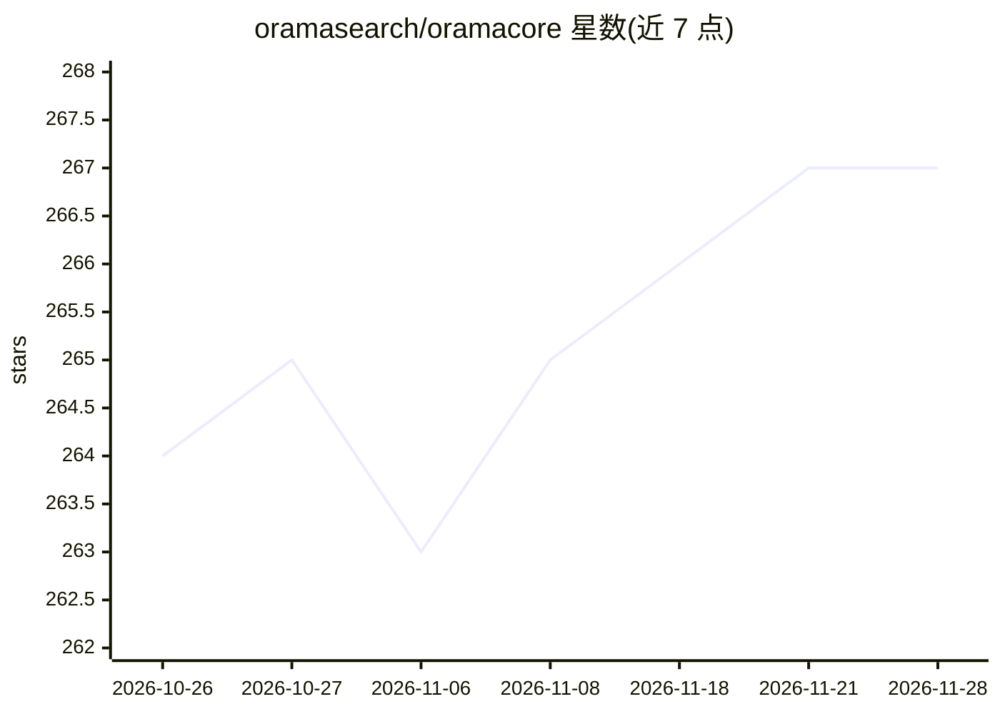

# oramasearch/oramacore

⭐ 267 · Rust · AGPL-3.0 · 推送 2026-11-04 · [GitHub](https://github.com/oramasearch/oramacore) · [官网](https://docs.orama.com/docs/cloud) · 组织维护

**自建答案引擎与搜索的 AI 运行时：全文检索+向量库+LLM 接口**

一个面向项目、答案引擎、copilot 与搜索场景的运行时服务，包含全文搜索引擎、向量数据库、带动作规划与推理的 LLM 接口，以及可编写自定义 agent 的 JavaScript 运行时。通过 docker-compose 部署，文档写入后自动生成嵌入并存入内置向量库，支持向量、混合、全文三种检索方式及 Answer Session 问答。提供 JavaScript SDK、健康检查端点，支持多语言分词（含中日韩）。License 为 AGPLv3。

## 筛选速览

| 维度 | 判定 | 备注 |
|---|---|---|
| AI 角色 | `ai-ecosystem` | LLM/agent 周边工具 |
| 许可风险 | `viral` | AGPL-3.0 |
| 部署形态 | `self-host` | docker 或自建部署 |
| 模型依赖 | — | README 未给出锁定关系 |
| 硬件要求 | — | 无带数字的原话,不猜 |
| 安装摩擦 | `low` | 无编译、无系统依赖或容器化 |
| 成熟度 | — | 结构信号不足 |

## 能力要点

- 全文搜索引擎、向量数据库与 LLM 接口一体化运行时
- 自动生成嵌入并存入内置向量数据库
- 支持向量、混合、全文检索及 Answer Session
- 提供多架构 Docker 镜像与健康检查端点

## 适用场景

- 用自己的数据搭建类似答案引擎的问答服务
- 为应用提供混合全文与向量检索能力
- 在自有数据上编写运行自定义 agent

## 场景标签

`向量数据库` `RAG` `语义搜索` · 领域:知识与检索

## 证据(README 行号)

> L3: **OramaCore** is the AI runtime you need for your projects, answer engines,
> L7: interface with action planning and reasoning, a JavaScript runtime to write and

## 星数曲线

2026-10-26 264 → 2026-11-28 267（+3）

---
*卡片 v1 · prompt 1.4 · 生成 2026-11-25 · 置信度 mid · 依据 README sha `46b12a3d7558` · [字段定义](../../DATASET.md)*
