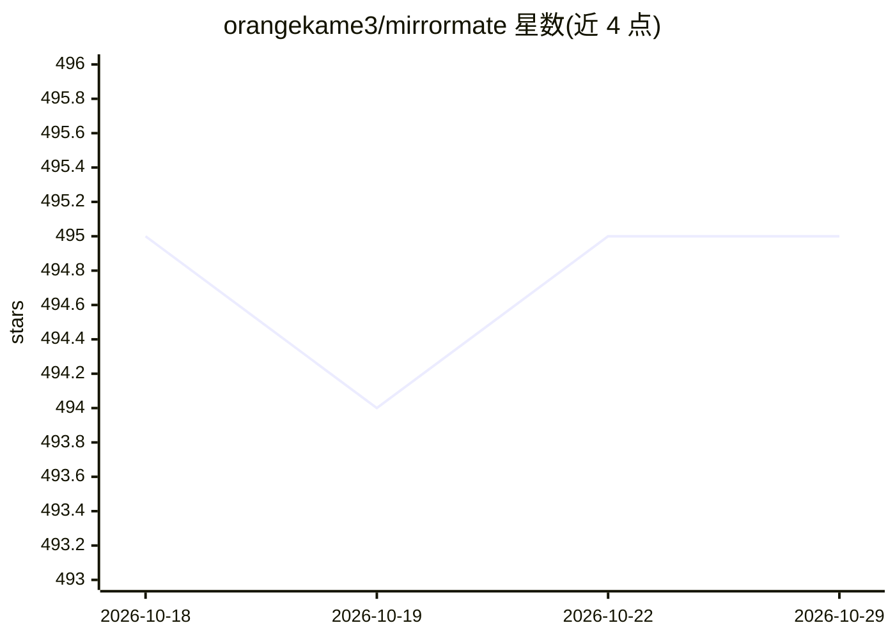

# orangekame3/mirrormate

⭐ 495 · TypeScript · MIT · 推送 2026-01-07 · [GitHub](https://github.com/orangekame3/mirrormate) · [官网](https://orangekame3.dev/mirrormate/) · 个人维护

**自托管的语音优先智能镜 AI 助手，可全本地运行**

运行在树莓派+半透镜硬件上的语音对话 AI 镜面应用：通过唤醒词（Hey Mira）激活，支持语音识别（Web Speech API/Whisper）、口型同步虚拟形象与八种动画状态。LLM 可选 OpenAI 或 Ollama，TTS 可选 OpenAI 或 VOICEVOX，实现全本地无云运行；通过 RAG 从对话中提取并检索个人记忆实现个性化。内置天气、日历、网页搜索、提醒与 Discord 分享集成，并提供插件系统。README 声明为进行中项目，核心功能可用但仍有粗糙之处。

## 筛选速览

| 维度 | 判定 | 备注 |
|---|---|---|
| AI 角色 | `ai-native` | 本体是模型或模型工具 |
| 许可风险 | `permissive` | MIT |
| 部署形态 | `self-host` | docker 或自建部署 |
| 模型依赖 | local-ok | 支持本地模型 |
| 硬件要求 | — | 无带数字的原话,不猜 |
| 安装摩擦 | `low` | 无编译、无系统依赖或容器化 |
| 成熟度 | `idea` | |

## 能力要点

- 唤醒词激活的语音优先交互，支持三种 STT 方案
- Ollama + VOICEVOX 全本地运行，无需云端
- RAG 记忆机制自动提取并检索个人信息
- 带八种动画状态的口型同步虚拟形象与插件系统

## 适用场景

- 用树莓派和半透镜 DIY 一面可对话的智能镜
- 早晨照镜时问天气、查日程或闲聊
- 在本地自托管环境下体验语音 AI 助手

## 场景标签

`语音 Agent` · 领域:对话与助手

## 证据(README 行号)

> L31: - A voice-first AI designed to live in a mirror
> L32: - Runs entirely local with Ollama + VOICEVOX (no cloud required)

## 星数曲线

2026-10-18 495 → 2026-10-29 495（+0）

---
*卡片 v1 · prompt 1.4 · 生成 2026-10-21 · 置信度 high · 依据 README sha `ef2cad039b02` · [字段定义](../../DATASET.md)*
