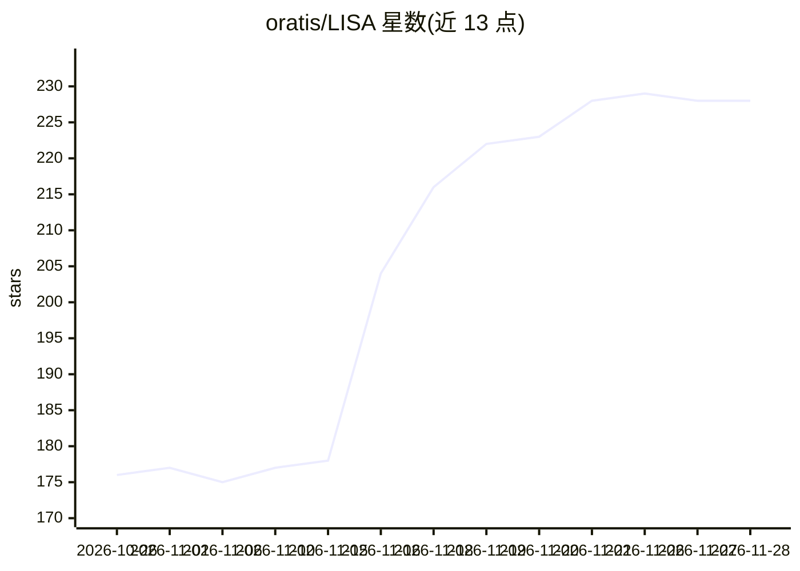

# oratis/LISA

⭐ 228 · TypeScript · MIT · 推送 2026-11-24 · [GitHub](https://github.com/oratis/LISA) · [官网](https://meetlisa.ai) · 组织维护 · 中文 README

**开源个人 AI 助手：规划、写作与个人知识管理**

面向个人的开源 AI 助手，覆盖日程规划、消息起草与个人知识库（链接保存、文章/视频转录摄取、wiki 搜索），并可在 Mac 上协调 Claude Code、Codex 等编程 agent。提供 Mac 应用、CLI/自托管 Web、LISA Cloud 与 iOS 客户端四种入口；持久化身份、记忆与反思机制（SOUL/DESIRES/HEARTBEAT/Rêve）维持跨会话上下文。云与本地为独立实例，数据不自动同步；远程模型会将上下文发送给对应服务商。MIT 许可，安装需 Node 22.19+ 或直接下载 DMG。

## 筛选速览

| 维度 | 判定 | 备注 |
|---|---|---|
| AI 角色 | `ai-native` | 本体是模型或模型工具 |
| 许可风险 | `permissive` | MIT |
| 部署形态 | `desktop` | 安装包/桌面程序 |
| 模型依赖 | local-ok | 支持本地模型 |
| 硬件要求 | — | 无带数字的原话,不猜 |
| 安装摩擦 | `low` | 无编译、无系统依赖或容器化 |
| 成熟度 | — | 结构信号不足 |

## 能力要点

- 四种运行入口：Mac 应用、CLI/自托管 Web、LISA Cloud、iOS Pocket
- 文件持久化的身份/记忆/反思机制与可恢复的历史版本
- 22 个只读本地连接器（Box、Obsidian、Feishu 等）与 MCP/skills/插件扩展
- Fleet 跨 Mac 编程 agent 协调：任务时间线、逐轮文件 diff 与合并确认

## 适用场景

- 日常规划与消息写作，生成可编辑草稿
- 搭建可搜索的个人知识库并从订阅源生成简报
- 在 Mac 上查看和交接 Claude Code/Codex 编程任务
- 用本地模型（Ollama/LM Studio）自托管运行助手

## 场景标签

`AI 助手` `知识库管理` · 领域:对话与助手

## 证据(README 行号)

> L14: **An open-source AI Personal Assistant for planning, writing and personal knowledge.** Plan a day, draft a message,
> L61: - **Coordinate coding agents across Macs.** Control observes supported Claude Code, Codex, OpenCode and Aider sessi

## 星数曲线

2026-10-26 176 → 2026-11-28 228（+52）

---
*卡片 v1 · prompt 1.4 · 生成 2026-11-27 · 置信度 high · 依据 README sha `f9226a3b0f17` · [字段定义](../../DATASET.md)*
