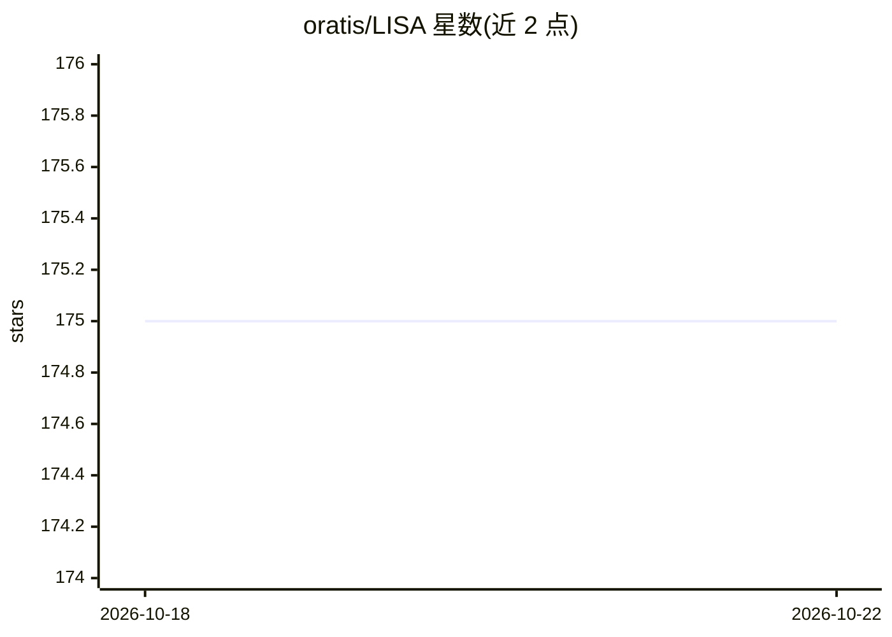

# oratis/LISA

⭐ 175 · TypeScript · MIT · 推送 2026-10-22 · [GitHub](https://github.com/oratis/LISA) · [官网](https://meetlisa.ai) · 组织维护 · 中文 README

**开源 AI 个人助手：规划、写作与个人知识管理，可本地或云端运行**

面向个人用户的 AI 助手，覆盖日程规划、写作起草、个人知识库（链接收藏、文章与视频转录摄入、订阅摘要）以及编码 agent（Claude Code、Codex、OpenCode、Aider）的观察与调度。提供 Mac 应用、CLI/自托管 Web 与 LISA Cloud 三种运行方式，Cloud 与 Mac 为隔离实例。机制上以文件持久化身份与记忆（SOUL/DESIRES/HEARTBEAT），Warden 提供可选的审批与审计；托管任务默认关闭。支持 Anthropic、OpenAI、Gemini 及本地模型（Ollama/LM Studio）。

## 筛选速览

| 维度 | 判定 | 备注 |
|---|---|---|
| AI 角色 | `ai-native` | 本体是模型或模型工具 |
| 许可风险 | `permissive` | MIT |
| 部署形态 | `desktop` | 安装包/桌面程序 |
| 模型依赖 | local-ok | 支持本地模型 |
| 硬件要求 | — | 无带数字的原话,不猜 |
| 安装摩擦 | `low` | 无编译、无系统依赖或容器化 |
| 成熟度 | — | 结构信号不足 |

## 能力要点

- 文件持久化的身份、记忆与反思机制（SOUL/DESIRES/HEARTBEAT/REVE）
- Warden 确定性动作审批、授权范围与审计记录（Web 聊天需显式开启）
- 观察与调度 Claude Code、Codex、OpenCode、Aider 编码 agent 会话
- Mac 应用、CLI/自托管 Web 与 LISA Cloud 三种运行入口

## 适用场景

- 日常规划、写作起草并沉淀个人知识库
- 在 Mac 上统一观察和调度多个编码 agent
- 自托管部署并自选模型（含本地 Ollama/LM Studio）
- 通过 Telegram/Discord/Slack/飞书等渠道连接本地工作流

## 场景标签

`AI 助手` `知识库管理` `AI 写作` · 领域:对话与助手

## 证据(README 行号)

> L12: **An open-source AI Personal Assistant for planning, writing and personal knowledge.** Plan a day, draft a message,
> L52: - **Start with everyday work.** Planning, writing and idea starters open editable drafts. Chat supports streaming r

## 星数曲线

2026-10-18 175 → 2026-10-22 175（+0）

---
*卡片 v1 · prompt 1.4 · 生成 2026-10-22 · 置信度 high · 依据 README sha `4d0c9f60e8c8` · [字段定义](../../DATASET.md)*
