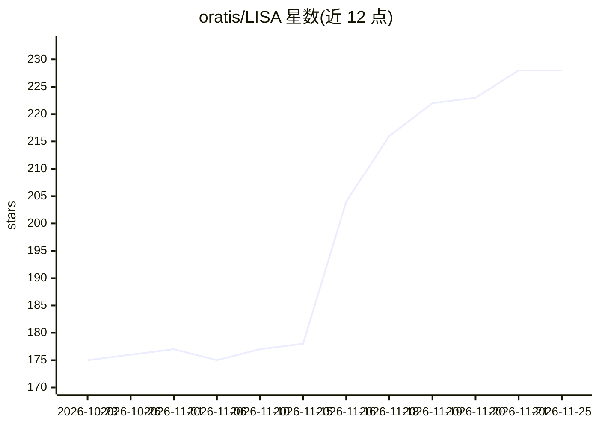

# oratis/LISA

⭐ 228 · TypeScript · MIT · 推送 2026-11-24 · [GitHub](https://github.com/oratis/LISA) · [官网](https://meetlisa.ai) · 组织维护

**开源 AI 个人助手：规划、写作与个人知识管理**

面向个人用户的 AI 助手，提供日程规划、写作草稿、个人知识库（链接保存、文章/视频转录摄入、wiki 检索）与编码 agent 协调等能力。运行入口包括 Mac 应用（dmg 安装包）、CLI/自托管 Web（需 Node 22.19+ 与模型密钥）、LISA Cloud 托管聊天与 iOS 应用。支持文件化持久身份与记忆、22 个只读本地数据源连接器、Warden 审批机制与目标/例程等自主任务功能。Cloud 与本地为独立实例，数据不自动同步。

## 筛选速览

| 维度 | 判定 | 备注 |
|---|---|---|
| AI 角色 | `ai-native` | 本体是模型或模型工具 |
| 许可风险 | `permissive` | MIT |
| 部署形态 | `desktop` | 安装包/桌面程序 |
| 模型依赖 | — | README 未给出锁定关系 |
| 硬件要求 | — | 无带数字的原话,不猜 |
| 安装摩擦 | `low` | 无编译、无系统依赖或容器化 |
| 成熟度 | — | 结构信号不足 |

## 能力要点

- 四种运行入口：Mac 应用、CLI/自托管 Web、Cloud、iOS
- 文件化持久身份/记忆机制（SOUL/DESIRES/HEARTBEAT/RÊVE）
- 22 个只读本地连接器（文档、任务、日历、邮件、设计工具）
- Control/Fleet 跨 Mac 协调 Claude Code、Codex、OpenCode、Aider 会话

## 适用场景

- 在 Mac 上用自有模型密钥运行个人 AI 助手
- 保存链接与文章构建可检索的个人知识库
- 在多台 Mac 间启动并审查编码 agent 任务
- 通过 Discord/飞书等渠道接入助手对话

## 场景标签

`编码 Agent` `AI 助手` `知识库管理` · 领域:编码与开发

## 证据(README 行号)

> L14: **An open-source AI Personal Assistant for planning, writing and personal knowledge.** Plan a day, draft a message,
> L54: Anthropic, OpenAI, Gemini, OpenAI-compatible services and local models are supported. See providers for keys, model
> L61: - **Coordinate coding agents across Macs.** Control observes supported Claude Code, Codex, OpenCode and Aider sessi

## 星数曲线

2026-10-23 175 → 2026-11-25 228（+53）

---
*卡片 v1 · prompt 1.4 · 生成 2026-11-25 · 置信度 high · 依据 README sha `9f2f010e8bd8` · [字段定义](../../DATASET.md)*
