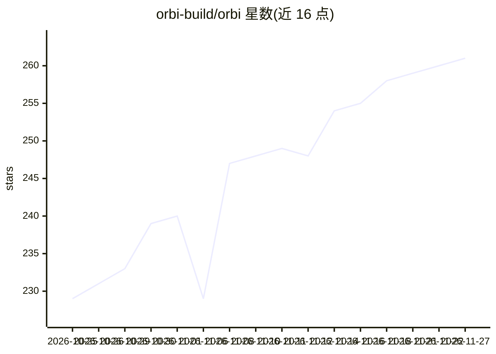

# orbi-build/orbi

⭐ 261 · Python · AGPL-3.0 · 推送 2026-11-26 · [GitHub](https://github.com/orbi-build/orbi) · [官网](https://orbi.build) · 组织维护 · 中文 README

**给 GitHub 团队的自动化交付工厂：打标签即得评审合并的 PR**

Orbi 是一个自托管的自动化软件开发交付系统：在 GitHub Issue 上标注 ai-ready 后，它在隔离 worktree 中规划、实现并测试代码，开启 PR，经独立评审会话修复发现项后通过合并门禁合并；请求发布时运行发布门禁并产出 tag 与 release notes。以 GitHub Issues 作为唯一状态存储，无数据库、队列或守护进程，由 systemd/launchd 定时器每 5 分钟触发一次运行；失败标记 ai-blocked 交由人工决策。通过 uv/pip 安装，依赖 GitHub CLI 与 Pi 运行时。

## 筛选速览

| 维度 | 判定 | 备注 |
|---|---|---|
| AI 角色 | `ai-native` | 本体是模型或模型工具 |
| 许可风险 | `viral` | AGPL-3.0 |
| 部署形态 | `library` | 以包/库形式分发 |
| 模型依赖 | — | README 未给出锁定关系 |
| 硬件要求 | — | 无带数字的原话,不猜 |
| 安装摩擦 | `low` | 无编译、无系统依赖或容器化 |
| 成熟度 | — | 结构信号不足 |

## 能力要点

- Issue 打 ai-ready 标签即自动走完实现、测试、评审、合并流程
- 独立评审会话与合并门禁，AI 不直接合并或推送受保护分支
- GitHub Issues 为唯一状态存储，无数据库/队列/守护进程
- Linux systemd / macOS launchd 定时器每 5 分钟自动触发，带 doctor 诊断命令

## 适用场景

- 把打标签的 Issue 交由系统自动实现并开 PR
- 需要代码经独立评审通过后才允许合并的流程管控
- 自托管环境下按定时调度自动消化任务队列

## 场景标签

`编码 Agent` `代码审查` · 领域:编码与开发

## 证据(README 行号)

> L13: Orbi is an open-source **software dark factory**: a software delivery system for GitHub. You define the goal and ac
> L72:   → Pi development: plan → implement → test → verify

## 星数曲线

2026-10-25 229 → 2026-11-27 261（+32）

---
*卡片 v1 · prompt 1.4 · 生成 2026-11-26 · 置信度 high · 依据 README sha `ca114ea39680` · [字段定义](../../DATASET.md)*
