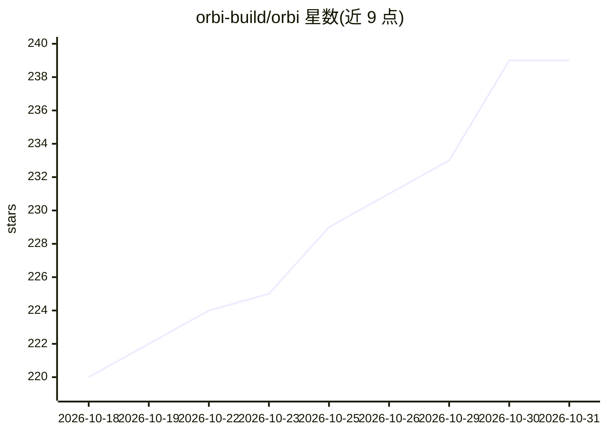

# orbi-build/orbi

⭐ 239 · Python · AGPL-3.0 · 推送 2026-10-30 · [GitHub](https://github.com/orbi-build/orbi) · [官网](https://orbi.build) · 组织维护 · 中文 README

**给维护 GitHub 仓库的开发者：标标签 Issue，自动产出已评审合并的 PR 与发布**

自托管（AGPL-3.0）的自动化软件交付系统：在 GitHub Issue 中写明目标与验收标准并打上 ai-ready 标签后，系统在隔离 worktree 中调度 Pi agent 规划、实现、测试，提交后由 Runner 创建 PR，再经独立评审会话修复问题，通过合并门禁后合并；按需执行发布门禁并打 tag 写发布说明。GitHub Issues 是唯一状态存储，无数据库/队列/守护进程，由 systemd/launchd 定时器每 5 分钟触发一次。失败标记 ai-blocked 交人工决定，AI 不合并或推送受保护分支。另提供托管版 Orbi Cloud。

## 筛选速览

| 维度 | 判定 | 备注 |
|---|---|---|
| AI 角色 | `ai-native` | 本体是模型或模型工具 |
| 许可风险 | `viral` | AGPL-3.0 |
| 部署形态 | `library` | 以包/库形式分发 |
| 模型依赖 | — | README 未给出锁定关系 |
| 硬件要求 | — | 无带数字的原话,不猜 |
| 安装摩擦 | `low` | 无编译、无系统依赖或容器化 |
| 成熟度 | — | 结构信号不足 |

## 能力要点

- Issue 打 ai-ready 标签 → 独立评审的 PR → 合并 → 打 tag 发布的全自动闭环
- GitHub Issues 为唯一状态存储，无数据库、队列或守护进程
- 独立评审会话与合并门禁，AI 不合并/推送受保护分支
- 每个任务独立 run_id，日志与 GitHub 评论可一条 grep 重建完整时间线

## 适用场景

- 给仓库 Issue 打标签后让系统自动实现并交付合并的 PR
- 自动执行发布门禁并生成 tag 与发布说明
- 自托管运行全自动软件交付流水线，无需额外任务系统

## 场景标签

`编码 Agent` · 领域:编码与开发

## 证据(README 行号)

> L13: Orbi is an open-source **software dark factory**: a software delivery system for GitHub. You define the goal and ac
> L71:   → Pi development: plan → implement → test → verify

## 星数曲线

2026-10-18 220 → 2026-10-31 239（+19）

---
*卡片 v1 · prompt 1.4 · 生成 2026-10-22 · 置信度 high · 依据 README sha `3406973a25e7` · [字段定义](../../DATASET.md)*
