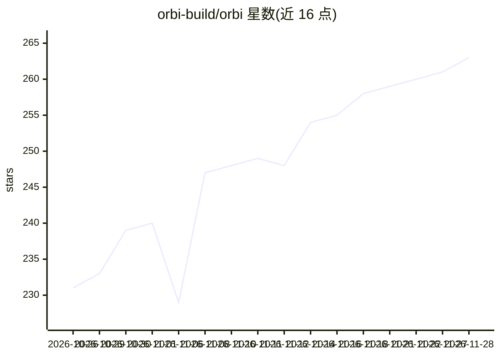

# orbi-build/orbi

⭐ 263 · Python · AGPL-3.0 · 推送 2026-11-27 · [GitHub](https://github.com/orbi-build/orbi) · [官网](https://orbi.build) · 组织维护 · 中文 README

**自托管软件工厂：打标签的 GitHub Issue 自动变成已审查合并的 PR**

面向 GitHub 仓库的自动化软件交付系统：在 Issue 中写明目标与验收标准并打 `ai-ready` 标签后，系统在隔离 worktree 中实现、运行测试、开 PR，并经独立审查会话修复后合并；请求发布时运行发布门禁并生成 tag 与 release notes。GitHub Issues 是唯一状态存储，无数据库、队列或守护进程；由 systemd（Linux）或 launchd（macOS）定时器每 5 分钟触发一次 tick。依赖 Python ≥ 3.14、uv、GitHub CLI ≥ 2.99 与 Pi 提供方。Cloud 版提供 14 天试用。

## 筛选速览

| 维度 | 判定 | 备注 |
|---|---|---|
| AI 角色 | `ai-native` | 本体是模型或模型工具 |
| 许可风险 | `viral` | AGPL-3.0 |
| 部署形态 | `library` | 以包/库形式分发 |
| 模型依赖 | — | README 未给出锁定关系 |
| 硬件要求 | — | 无带数字的原话,不猜 |
| 安装摩擦 | `low` | 无编译、无系统依赖或容器化 |
| 成熟度 | — | 结构信号不足 |

## 能力要点

- Issue 打 `ai-ready` 标签即触发全自动交付循环
- 独立审查会话 + 合并门禁，CI 绿灯且审查通过才合并
- GitHub Issues 唯一状态存储，无数据库/队列/守护进程
- 以 `run_id` 关联日志与进度评论，完整时间线可追溯

## 适用场景

- 把打标签的 bug Issue 自动变成已审查合并的 PR
- 请求发布时自动跑发布门禁并生成 tag 与 release notes
- 在 Claude Code / Cursor / GitHub Copilot 中集成 Orbi 插件命令

## 场景标签

`编码 Agent` `代码审查` · 领域:编码与开发

## 证据(README 行号)

> L15: Orbi is an open-source **software dark factory**: a software delivery system for GitHub. You define the goal and ac
> L89:   → Pi development: plan → implement → test → verify
> L80: - **Independent review + merge gates**: after a PR opens, an independent review session reviews it and fixes findin

## 星数曲线

2026-10-26 231 → 2026-11-28 263（+32）

---
*卡片 v1 · prompt 1.4 · 生成 2026-11-28 · 置信度 high · 依据 README sha `6dff89dafd50` · [字段定义](../../DATASET.md)*
