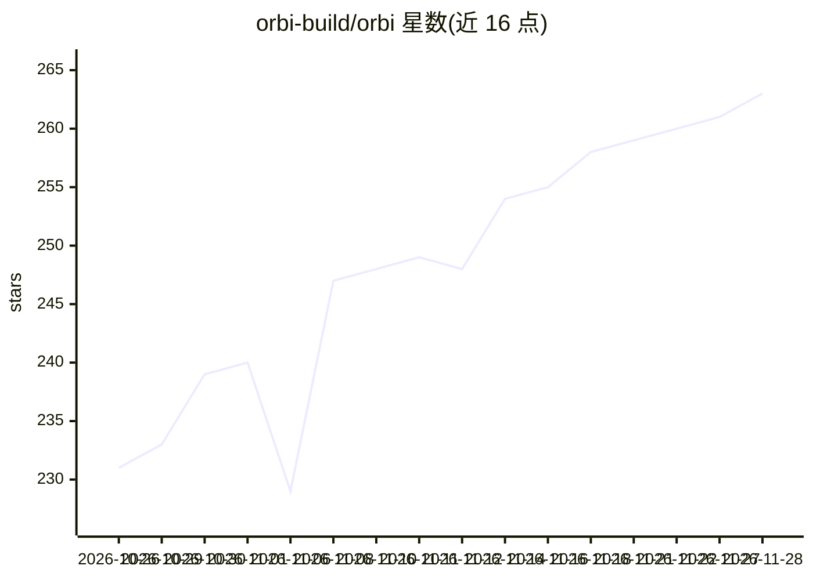

# orbi-build/orbi

⭐ 263 · Python · AGPL-3.0 · 推送 2026-11-27 · [GitHub](https://github.com/orbi-build/orbi) · [官网](https://orbi.build) · 组织维护

**自托管自动化软件工厂：标记 GitHub Issue 即得已评审合并的 PR**

面向 GitHub 的自动化软件交付系统：在 Issue 中定义目标与验收标准并打上 `ai-ready` 标签后，系统在隔离 worktree 中实现代码、运行测试、开启 PR，并经独立评审会话修复问题后合并；请求发布时执行发布门禁并生成 tag 与 release notes。GitHub Issues 是唯一状态存储，无数据库、队列或守护进程；由 systemd/launchd 定时器每 5 分钟触发运行，失败时将 Issue 标记为 `ai-blocked` 交由人工决策。底层开发由 Pi agent 完成，提供 CLI 与 doctor 诊断。

## 筛选速览

| 维度 | 判定 | 备注 |
|---|---|---|
| AI 角色 | `ai-native` | 本体是模型或模型工具 |
| 许可风险 | `viral` | AGPL-3.0 |
| 部署形态 | `library` | 以包/库形式分发 |
| 模型依赖 | — | README 未给出锁定关系 |
| 硬件要求 | — | 无带数字的原话,不猜 |
| 安装摩擦 | `low` | 无编译、无系统依赖或容器化 |
| 成熟度 | — | 结构信号不足 |

## 能力要点

- Issue 打标签后自动完成实现、测试、PR、独立评审与合并全流程
- 独立评审会话与合并门禁：评审通过且最新基址 CI 绿灯才合并
- GitHub Issues 作为唯一状态存储，无数据库与守护进程
- 每次运行关联同一 run_id，全链路日志可一条 grep 重建时间线

## 适用场景

- 把打标签的 bug/功能 Issue 交给后台自动产出 PR 与发布
- 要求 AI 生成代码必须经过独立评审才能进入主干
- 自托管环境下以 GitHub 为唯一任务池管理后台 agent 工作

## 场景标签

`编码 Agent` `代码审查` `工作流自动化` · 领域:效率与自动化

## 证据(README 行号)

> L15: Orbi is an open-source **software dark factory**: a software delivery system for GitHub. You define the goal and ac
> L80: - **Independent review + merge gates**: after a PR opens, an independent review session reviews it and fixes findin
> L89:   → Pi development: plan → implement → test → verify

## 星数曲线

2026-10-26 231 → 2026-11-28 263（+32）

---
*卡片 v1 · prompt 1.4 · 生成 2026-11-27 · 置信度 high · 依据 README sha `ad0786d6660e` · [字段定义](../../DATASET.md)*
