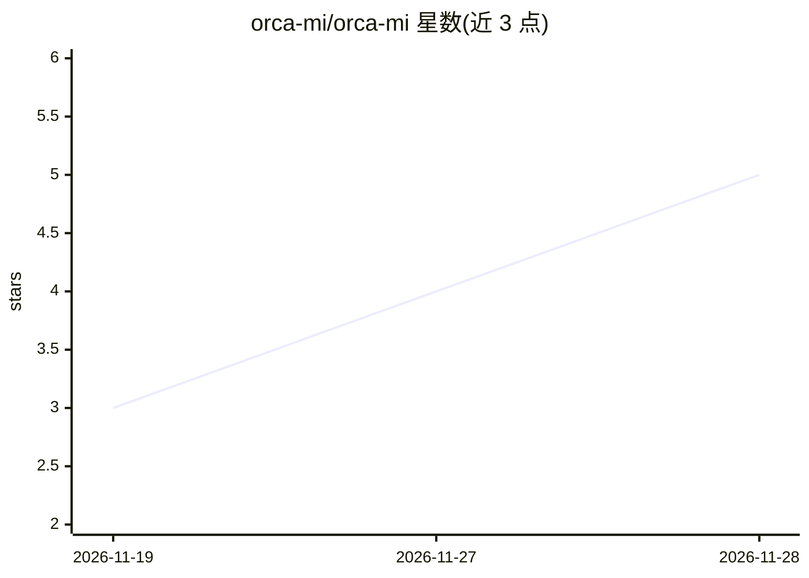

# orca-mi/orca-mi

⭐ 5 · NOASSERTION · 推送 2026-11-26 · [GitHub](https://github.com/orca-mi/orca-mi) · [官网](https://orca-mi.github.io) · 个人维护

**面向分子影像研究的 Windows 工作站：浏览、融合、分割与剂量计算**

单个 Windows 程序的分子影像工作站，读取 DICOM、NIfTI、NRRD 等格式，提供 PET/CT 与 SPECT/CT 融合、GPU 3D、手动与 AI 分割、SUV/MTV/TLG 测量、动态与多时间点分析、Q.SPECT、NEMA 模体分析、配准、剂量计算及 DICOM 导出回 PACS。AI 分割依赖可选的私有 Python+PyTorch 环境（程序内一键安装），模型可从内置模型库下载或自行训练 nnU-Net。仅供研究使用，非医疗器械；提供 Windows 安装包/便携版、Ubuntu 测试版与浏览器受限版。

## 筛选速览

| 维度 | 判定 | 备注 |
|---|---|---|
| AI 角色 | `ai-enhanced` | 去掉 AI 部分产品仍成立 |
| 许可风险 | `none` | NOASSERTION |
| 部署形态 | `desktop` | 安装包/桌面程序 |
| 模型依赖 | — | README 未给出锁定关系 |
| 硬件要求 | — | 无带数字的原话,不猜 |
| 安装摩擦 | `low` | 无编译、无系统依赖或容器化 |
| 成熟度 | — | 结构信号不足 |

## 能力要点

- 读取 DICOM/NIfTI/NRRD 等，PET/CT 融合与 GPU 3D 显示
- AI 分割：nnInteractive（点击/框/涂鸦）、nnU-Net、PET 病灶分割与一键体轮廓
- SUV/SUL/MTV/TLG 测量、Patlak Ki、Q.SPECT、NEMA IEC 模体与扫描仪校准
- 批量 DICOM→NIfTI 转换（含 dcm2niix）与 DICOM SEG/RTSTRUCT/SR 导出回 PACS

## 适用场景

- 科研中查看与融合 PET/CT、SPECT/CT 影像并测量 SUV 指标
- 用 AI 模型对病灶做分割并导出 DICOM SEG 到 PACS
- 批量把 DICOM 影像转换为 NIfTI 并提取头信息表
- 做靶向治疗剂量计算与 NEMA 模体/扫描仪质控分析

## 场景标签

`科研工具` `图像视频处理` · 领域:学习与行业

## 证据(README 行号)

> L7: PET · SPECT · CT · MR &nbsp;—&nbsp; viewing, fusion, 3D, AI segmentation, quantification, dosimetry, registration
> L91: |**AI**|one-click private Python + PyTorch installer, model library, train your own nnU-Net, fine-tune nnInteractiv
> L142: The AI features need a Python environment with PyTorch: **Tools → Install AI environment** sets up a private one

## 星数曲线

2026-11-19 3 → 2026-11-28 5（+2）

---
*卡片 v1 · prompt 1.4 · 生成 2026-11-21 · 置信度 high · 依据 README sha `aec652349387` · [字段定义](../../DATASET.md)*
