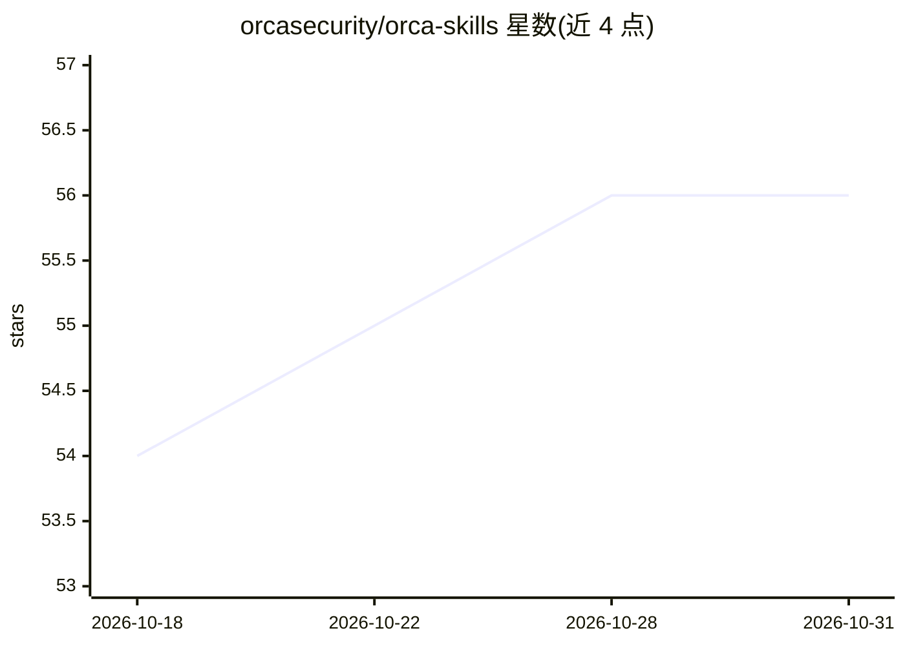

# orcasecurity/orca-skills

⭐ 56 · Python · MIT · 推送 2026-10-28 · [GitHub](https://github.com/orcasecurity/orca-skills) · [官网](https://orca.security/) · 组织维护

**Orca 云安全平台的 agent 技能与插件集，用于安全工作流**

由 Orca Security 维护的技能市场仓库，包含两个插件：orca-skills 提供 20 个云安全分析技能，通过 Orca MCP server 读取云端态势数据并给出解释与修复建议；security-engineer 是自主修复代理，在源码仓库中修复 Orca 发现的问题并为每个修复开 PR。支持 Claude Code 与 Codex 两种客户端安装，也支持 Claude Desktop 与手动克隆。orca-skills 必须配置 Orca MCP server（OAuth2 或 token 认证），security-engineer 则直接调用 Orca API 并需 Python 3.10+、gh 认证等前置条件。

## 筛选速览

| 维度 | 判定 | 备注 |
|---|---|---|
| AI 角色 | `ai-ecosystem` | LLM/agent 周边工具 |
| 许可风险 | `permissive` | MIT |
| 部署形态 | `library` | 以包/库形式分发 |
| 模型依赖 | — | README 未给出锁定关系 |
| 硬件要求 | — | 无带数字的原话,不猜 |
| 安装摩擦 | `low` | 无编译、无系统依赖或容器化 |
| 成熟度 | — | 结构信号不足 |

## 能力要点

- 20 个云安全技能覆盖告警分诊、影响分析、配置溯源、合规差距等场景
- security-engineer 自主修复 Orca 发现并按修复逐个开 PR
- 同一 skills/ 目录同时支持 Claude Code 与 Codex 客户端
- 技能需配合 Orca Security MCP server（OAuth2/token 两种认证）读取环境数据

## 适用场景

- 在 Claude Code 或 Codex 中分诊和解释 Orca 云安全告警
- 分析修复某个告警会影响哪些资产与合规项
- 让 security-engineer 在源码仓库中自动修复云安全问题并提交 PR
- 每日获取云环境安全晨报

## 场景标签

`网络安全` `编码 Agent` · 领域:编码与开发

## 证据(README 行号)

> L21: |`orca-skills`|20 skills for cloud security analysis and guided remediation through the Orca MCP server|The Orca MC
> L115: **Required:** These skills need the Orca Security MCP server to access your environment data.
> L142: > **The `security-engineer` plugin does not read MCP.** It calls

## 星数曲线

2026-10-18 54 → 2026-10-31 56（+2）

---
*卡片 v1 · prompt 1.4 · 生成 2026-10-24 · 置信度 mid · 依据 README sha `06ef00044a03` · [字段定义](../../DATASET.md)*
