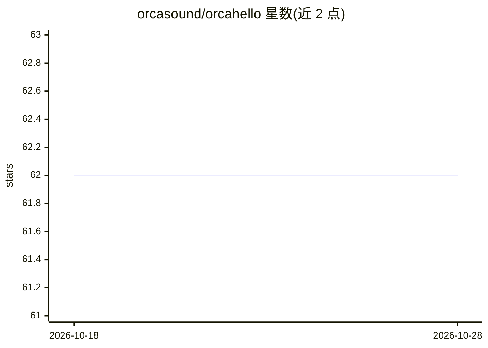

# orcasound/orcahello

⭐ 62 · C# · MIT · 推送 2026-10-27 · [GitHub](https://github.com/orcasound/orcahello) · [官网](http://ai4orcas.net/orcahello) · 组织维护

**实时虎鲸叫声 AI 检测与通知系统（模型+审核门户）**

Orcasound 维护的水听器网络实时推断系统：从 Puget Sound 水听器直播音频中，用深度学习二分类模型对 2 秒音频片段判定是否为虎鲸叫声；检测结果发送邮件给虎鲸专家审核，专家在 Moderator Portal 确认/否决并标注，确认南方居留型虎鲸（SRKW）后向研究人员、社区科学家、管理机构等订阅者发送通知。仓库包含前端、通知、推理、模型训练与评测五个组件，数据流基于 AWS 流媒体与 Azure 分析。

## 筛选速览

| 维度 | 判定 | 备注 |
|---|---|---|
| AI 角色 | `ai-native` | 本体是模型或模型工具 |
| 许可风险 | `permissive` | MIT |
| 部署形态 | `None` |  |
| 模型依赖 | — | README 未给出锁定关系 |
| 硬件要求 | — | 无带数字的原话,不猜 |
| 安装摩擦 | `low` | 无编译、无系统依赖或容器化 |
| 成熟度 | — | 结构信号不足 |

## 能力要点

- 深度学习模型对 2 秒音频片段做虎鲸叫声二分类，实时推断
- 专家审核门户：确认/否决模型检测并标注
- 确认 SRKW 后向多类订阅者（研究/管理/救援机构等）触发邮件通知
- 仓库含推理、模型训练、模型评测、通知系统与前端五个组件

## 适用场景

- 实时监听水听器音频并检测濒危虎鲸叫声
- 专家审核模型检测并触发订阅者通知
- 在自有数据集上训练与评测虎鲸叫声分类模型

## 场景标签

`模型训练` `模型评测` · 领域:评测与运维

## 证据(README 行号)

> L6: Through annual Microsoft hackathons since 2019 and with the volunteer efforts of many heroic Orcasound open source c
> L34: 2. **Azure-based analysis** (via AKS in 2021-2, ICI 2019-2020; ingestion of 10-second segments from S3, inference o
> L35: 3. **Moderation** of model detections by orca call experts (moderator notification, authentication in moderator por

## 星数曲线

2026-10-18 62 → 2026-10-28 62（+0）

---
*卡片 v1 · prompt 1.4 · 生成 2026-10-24 · 置信度 high · 依据 README sha `5b3f6c7c30e6` · [字段定义](../../DATASET.md)*
