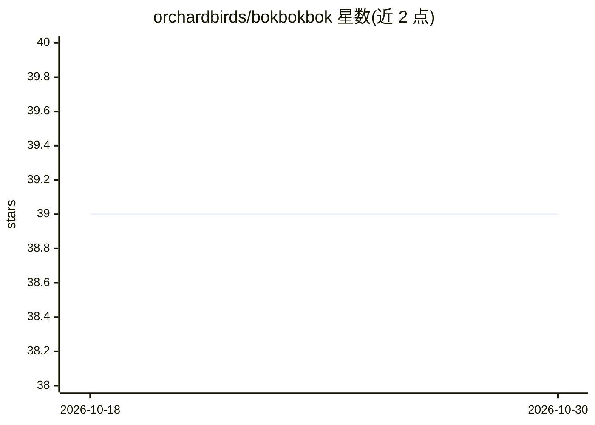

# orchardbirds/bokbokbok

⭐ 39 · Python · MIT · 推送 2026-05-05 · [GitHub](https://github.com/orchardbirds/bokbokbok) · [官网](https://orchardbirds.github.io/bokbokbok/) · 组织维护

**为 XGBoost/LightGBM 提供自定义损失函数与评估指标的 Python 包**

Python 包 bokbokbok，面向使用 XGBoost 和 LightGBM 的机器学习开发者，提供加权交叉熵、加权 Focal Loss、Log Cosh 损失、RMSPE、F1 score、二次加权 Kappa 等自定义损失函数与评估指标，用于分类（二分类）与回归任务。通过 pip 安装，附有文档链接。README 未列出与梯度提升库以外的框架集成或硬件要求。

## 筛选速览

| 维度 | 判定 | 备注 |
|---|---|---|
| AI 角色 | `ai-ecosystem` | LLM/agent 周边工具 |
| 许可风险 | `permissive` | MIT |
| 部署形态 | `library` | 以包/库形式分发 |
| 模型依赖 | — | README 未给出锁定关系 |
| 硬件要求 | — | 无带数字的原话,不猜 |
| 安装摩擦 | `low` | 无编译、无系统依赖或容器化 |
| 成熟度 | — | 结构信号不足 |

## 能力要点

- 提供加权交叉熵与加权 Focal Loss 损失函数
- 提供 RMSPE、F1 score、二次加权 Kappa 等评估指标
- 面向 XGBoost 与 LightGBM 两种梯度提升框架

## 适用场景

- 在不均衡二分类任务中给 XGBoost/LightGBM 换用 Focal Loss
- 用 RMSPE 等指标训练与评估回归模型
- 在训练中直接优化 F1 或二次加权 Kappa

## 场景标签

 · 领域:机器学习工具库

## 证据(README 行号)

> L10: **bokbokbok** is a python package that enables you to use Custom Loss Functions and Evaluation Metrics for XGBoost 
> L13: - Weighted Cross Entropy

## 星数曲线

2026-10-18 39 → 2026-10-30 39（+0）

---
*卡片 v1 · prompt 1.4 · 生成 2026-10-25 · 置信度 high · 依据 README sha `9cd65299cee2` · [字段定义](../../DATASET.md)*
