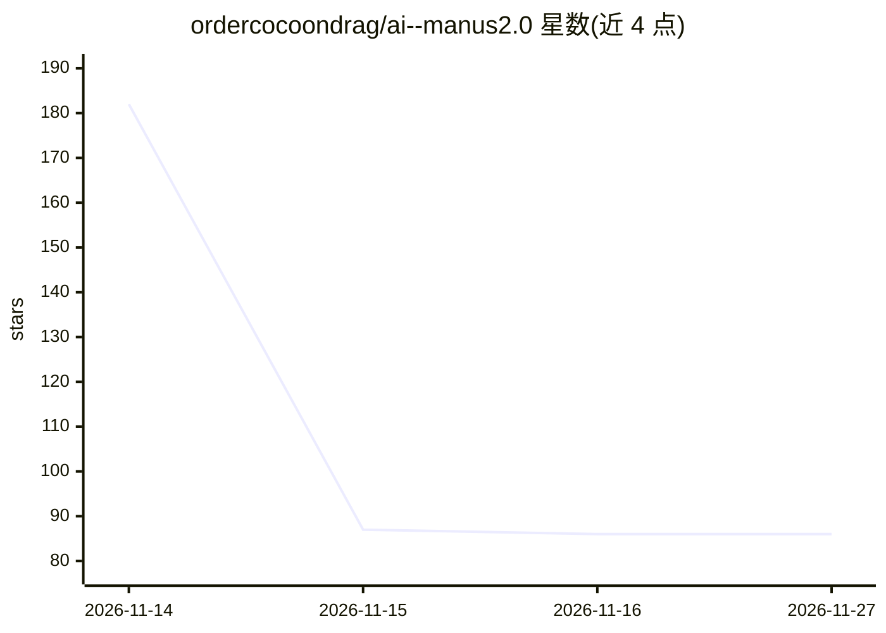

# ordercocoondrag/ai--manus2.0

⭐ 86 · Apache-2.0 · 推送 2026-11-15 · [GitHub](https://github.com/ordercocoondrag/ai--manus2.0) · 个人维护

**面向个人用户的自主 AI Agent：代替用户写代码、控制浏览器**

README 以营销式文案介绍 Manus：一个自主执行任务的 AI agent，可自行编写并运行脚本、控制浏览器完成打开网页、填表、跨页信息收集等多步骤任务，定位为家庭、学习与轻量办公场景的个人助手，而非企业平台。文中描述了任务配置流程与最小系统要求（双核 CPU、4 GB 内存），但未给出任何具体安装命令、代码仓库内容或技术实现细节，仅含下载提示与促销码。

## 筛选速览

| 维度 | 判定 | 备注 |
|---|---|---|
| AI 角色 | `ai-native` | 本体是模型或模型工具 |
| 许可风险 | `permissive` | Apache-2.0 |
| 部署形态 | `None` |  |
| 模型依赖 | — | README 未给出锁定关系 |
| 硬件要求 | — | 无带数字的原话,不猜 |
| 安装摩擦 | `low` | 无编译、无系统依赖或容器化 |
| 成熟度 | — | 结构信号不足 |

## 能力要点

- 自主编写并执行代码完成任务
- 浏览器控制：导航网页、填表、收集信息
- 脚本与浏览器动作可在同一任务流中衔接
- 最小系统要求：双核 CPU、4 GB 内存

## 适用场景

- 让学生组织研究笔记、运行小脚本
- 远程办公时从多个网页收集数据
- 日常重复性小任务（查网页、整理文件）的委托执行

## 场景标签

`AI 助手` `浏览器自动化` · 领域:效率与自动化

## 证据(README 行号)

> L10: - **Autonomous Code Execution:** Manus AI agent runs code on its own to complete tasks, so you can focus on decisio
> L18: Manus is an autonomous AI agent designed to run code and control a browser on your behalf. Instead of acting like a

## 星数曲线

2026-11-14 182 → 2026-11-27 86（-96）

---
*卡片 v1 · prompt 1.4 · 生成 2026-11-17 · 置信度 low · 依据 README sha `637da4fbcded` · [字段定义](../../DATASET.md)*
