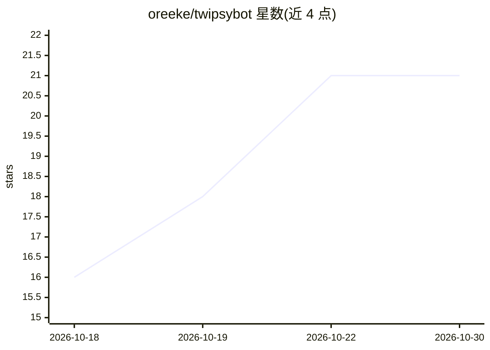

# oreeke/twipsybot

⭐ 21 · Python · MIT · 推送 2026-10-28 · [GitHub](https://github.com/oreeke/twipsybot) · [官网](https://twipsybot.oreeke.com) · 个人维护

**面向 Misskey 联邦宇宙的插件化 AI 机器人**

用 Python 编写的轻量 Misskey 机器人，通过 OpenAI 兼容 API 接入大语言模型，在联邦宇宙平台上以账号形式运行（示例账号 oreeke.com/@ai）。支持插件化扩展，要求 Python 3.12+ 与 Misskey 2026+。官方提供 GHCR 上的 Docker 镜像，README 给出 docker compose 部署流程：复制并编辑 docker-compose.yaml 后启动容器，再在容器内执行 twipsybot cfg 完成配置。另提供使用手册与开发指南链接。

## 筛选速览

| 维度 | 判定 | 备注 |
|---|---|---|
| AI 角色 | `ai-native` | 本体是模型或模型工具 |
| 许可风险 | `permissive` | MIT |
| 部署形态 | `self-host` | docker 或自建部署 |
| 模型依赖 | — | README 未给出锁定关系 |
| 硬件要求 | — | 无带数字的原话,不猜 |
| 安装摩擦 | `low` | 无编译、无系统依赖或容器化 |
| 成熟度 | — | 结构信号不足 |

## 能力要点

- 插件化架构的 Misskey AI 机器人
- 通过 OpenAI 兼容 API 接入 LLM
- 提供 GHCR Docker 镜像与 docker compose 部署流程

## 适用场景

- 在 Misskey 实例上部署一个可对话的 AI 账号
- 通过插件扩展机器人在联邦宇宙中的功能

## 场景标签

`聊天机器人` · 领域:对话与助手

## 证据(README 行号)

> L1: TwipsyBot
> L5:  **一只轻量、插件化的 Misskey AI 机器人**

## 星数曲线

2026-10-18 16 → 2026-10-30 21（+5）

---
*卡片 v1 · prompt 1.4 · 生成 2026-10-28 · 置信度 mid · 依据 README sha `f257a6fd53e5` · [字段定义](../../DATASET.md)*
