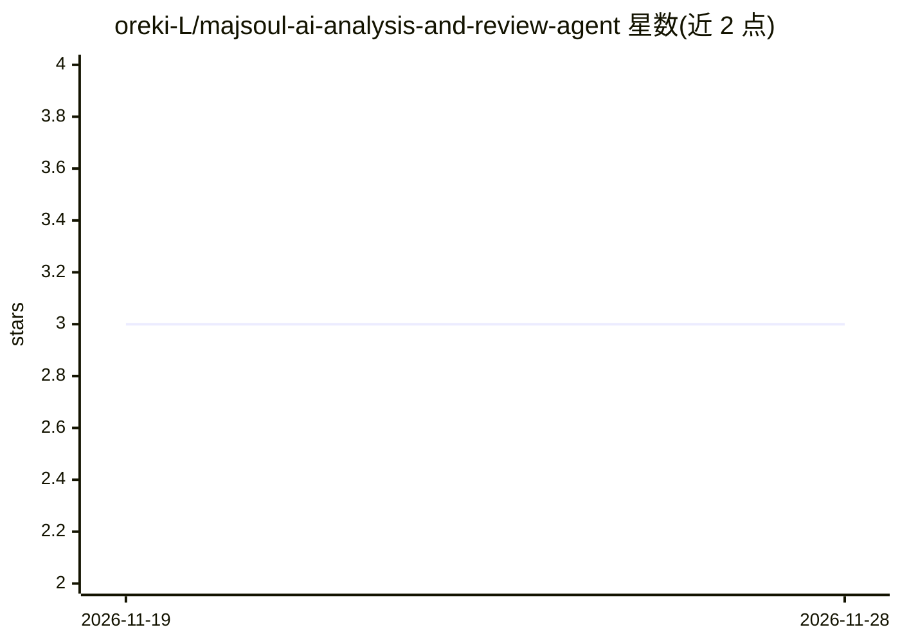

# oreki-L/majsoul-ai-analysis-and-review-agent

⭐ 3 · JavaScript · MIT · 推送 2026-11-27 · [GitHub](https://github.com/oreki-L/majsoul-ai-analysis-and-review-agent) · 个人维护 · 中文 README

**雀魂玩家浏览器扩展：用自配 LLM 讲解每手牌的取舍**

浏览器扩展，接入雀魂网页版（game.maj-soul.com）：本地计算向听、有效牌与危险证据；可配置用户自己的 Chat Completions 兼容 LLM 服务（需支持 function tools）讲解局面，或接入本地 Mortal / Akagi 引擎给出动作。核心流程为当场分析、针对决策连续追问、历史回看继续讨论，讨论保存在本机。提供标准 Agent 扩展、可选聊天版、Windows x64 本地模型运行包与独立 Collector 四类下载；追问讨论与用量记录受本机存储容量限制。

## 筛选速览

| 维度 | 判定 | 备注 |
|---|---|---|
| AI 角色 | `ai-native` | 本体是模型或模型工具 |
| 许可风险 | `permissive` | MIT |
| 部署形态 | `None` |  |
| 模型依赖 | — | README 未给出锁定关系 |
| 硬件要求 | — | 无带数字的原话,不猜 |
| 安装摩擦 | `low` | 无编译、无系统依赖或容器化 |
| 成熟度 | — | 结构信号不足 |

## 能力要点

- 本地牌效计算无需 API Key，接入 LLM 只填服务地址、模型名称与密钥
- 围绕单个决策的连续追问，前轮问答进入后续讨论并支持历史回看
- 引擎动作校验后先显示，LLM 只读讲解且不能改写引擎首选
- 可选本地运行包提供 Mortal / Akagi 多模型管理与切换

## 适用场景

- 对局中查看牌效建议与危险依据并追问取舍原因
- 用自己配置的 LLM 服务复盘已保存的对局决策
- 本机运行 Mortal / Akagi 引擎获取动作并结合 LLM 讲解
- 只采集、展示与导出牌局数据（独立 Collector）

## 场景标签

 · 领域:游戏/桌面工具

## 证据(README 行号)

> L5: 浏览器扩展直接分析雀魂网页版：查看牌效与危险依据，用自己的 LLM 讲解局面，或接入本地 Mortal / Akagi 引擎给出动作。遇到不懂的建议，可以围绕当时那一手连续追问，之后再回看。
> L94: |服务地址|服务商提供的 Chat Completions 兼容地址，例如 `https://api.openai.com/v1`|
> L98: 3. 勾选“开启模型分析”，点击“保存设置”，允许浏览器访问所配置接口。**接口须支持 function tools**；需要检查连接时，可使用“发送测试请求（可能收费）”。

## 星数曲线

2026-11-19 3 → 2026-11-28 3（+0）

---
*卡片 v1 · prompt 1.4 · 生成 2026-11-21 · 置信度 high · 依据 README sha `996b8b7b2805` · [字段定义](../../DATASET.md)*
