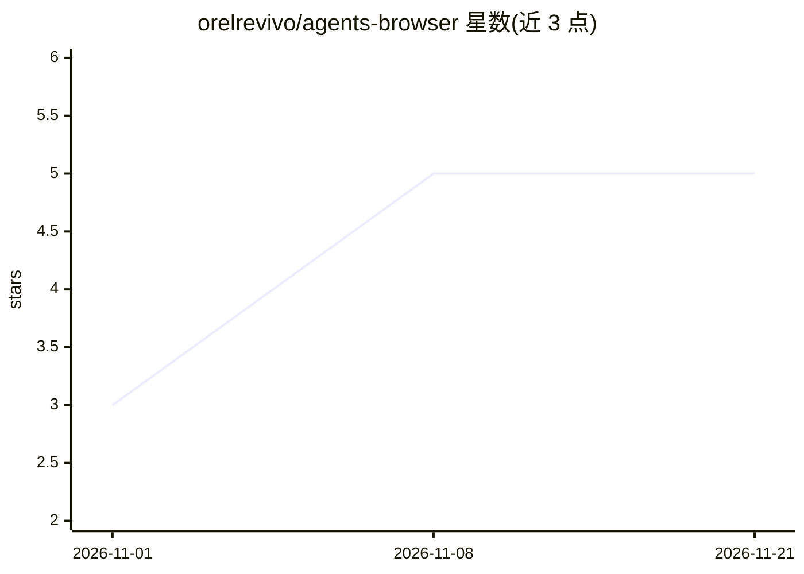

# orelrevivo/agents-browser

⭐ 5 · TypeScript · 推送 2026-10-30 · [GitHub](https://github.com/orelrevivo/agents-browser) · 个人维护

**AI 原生浏览器：多个自定义代理在浏览会话中协作完成任务**

开源的 AI 原生浏览器项目 Groubot，代理在用户的浏览会话内执行研究、整理与任务操作，提供专门的代理管理、聊天工作区、技能、代理分组、市场与 SQLite 本地持久化。当前为早期阶段：Linux 原生 CEF host 使用 X11，macOS/Windows host 尚未提供。需要 Node.js 22+、pnpm 10+ 与 OpenAI API key，首个启动会下载或本地构建 CEF host。

## 筛选速览

| 维度 | 判定 | 备注 |
|---|---|---|
| AI 角色 | `ai-native` | 本体是模型或模型工具 |
| 许可风险 | `none` | — |
| 部署形态 | `library` | 以包/库形式分发 |
| 模型依赖 | — | README 未给出锁定关系 |
| 硬件要求 | — | 无带数字的原话,不猜 |
| 安装摩擦 | `medium` | 含编译或系统依赖之一 |
| 成熟度 | `idea` | |

## 能力要点

- 多个专门化代理在同一浏览器工作区协作，权限可分配
- 代理、聊天、技能与分组数据本地 SQLite 持久化
- 桌面应用经 pnpm workspace 组织，含 packages/ai、packages/browser 等模块
- 网页内容仅在代理执行或工具调用需要时发送给 AI 提供商

## 适用场景

- 让多个代理在浏览器中代为完成日常研究、整理任务
- 为不同任务创建带独立指令的专门代理团队
- 在本地保存代理与对话数据，控制代理权限

## 场景标签

`浏览器自动化` `多智能体` `AI 助手` · 领域:Agent 开发

## 证据(README 行号)

> L5: Groubot is an open-source, AI-native browser where customizable agents work directly inside your browsing sessions—r
> L19: Groubot is an actively developed early-stage project. The browser shell, local React interface, agent management, c
> L30: - An OpenAI API key with available account credits

## 星数曲线

2026-11-01 3 → 2026-11-21 5（+2）

---
*卡片 v1 · prompt 1.4 · 生成 2026-11-21 · 置信度 high · 依据 README sha `dfd2b0c373e8` · [字段定义](../../DATASET.md)*
