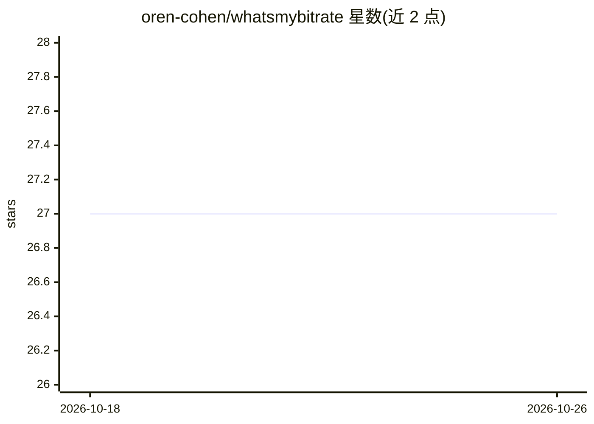

# oren-cohen/whatsmybitrate

⭐ 27 · Python · 推送 2026-07-08 · [GitHub](https://github.com/oren-cohen/whatsmybitrate) · [官网](https://whatsmybitrate.com) · 个人维护

**批量分析音频文件质量指标并生成频谱图的命令行工具**

面向音乐收藏管理者的 Python 命令行工具：递归扫描目录，用 ffprobe 提取编码格式、采样率、标称比特率等元数据，并基于频谱截止频率估算感知等效比特率（如 128/192/256/320 kbps）、判定无损/转码状态，生成 HTML（含频谱图）或 CSV 报告。支持 MP3、FLAC、WAV、AAC、M4A、OGG 等 8 种格式，可用 -m 参数启用多进程加速。运行依赖 Python 3.8-3.14 与系统安装的 FFmpeg。

## 筛选速览

| 维度 | 判定 | 备注 |
|---|---|---|
| AI 角色 | `ai-enhanced` | 去掉 AI 部分产品仍成立 |
| 许可风险 | `none` | — |
| 部署形态 | `desktop` | 安装包/桌面程序 |
| 模型依赖 | — | README 未给出锁定关系 |
| 硬件要求 | — | 无带数字的原话,不猜 |
| 安装摩擦 | `medium` | 含编译或系统依赖之一 |
| 成熟度 | — | 结构信号不足 |

## 能力要点

- 基于频谱截止估算感知等效比特率并判定无损/转码状态
- 支持 MP3/FLAC/WAV/AAC/M4A/OGG/AIFF/ALAC 共 8 种格式
- 递归扫描与多进程批量处理
- 输出含频谱图的 HTML 报告或 CSV 报告

## 适用场景

- 核对大批量音乐文件的真实音质与转码情况
- 为音频收藏生成可视化频谱图进行目视检查
- 导出 CSV 指标表用于表格分析或集成其他工具

## 场景标签

 · 领域:音频处理/工具

## 证据(README 行号)

> L12: - **Perceptual Quality Estimation:** Estimates the equivalent bitrate (e.g., 128, 192, 256, 320 kbps) based on spec
> L13: - **Spectrogram Generation:** Creates spectrogram images for visual analysis of the audio spectrum.

## 星数曲线

2026-10-18 27 → 2026-10-26 27（+0）

---
*卡片 v1 · prompt 1.4 · 生成 2026-10-26 · 置信度 low · 依据 README sha `706ba586c17b` · [字段定义](../../DATASET.md)*
